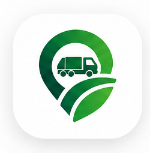
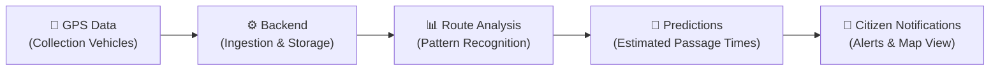

<h1 align="center">KOLEKTA</h1>

  

  <strong>Sabe quando. Vive melhor.</strong> 
  Civic technology for waste collection in Luanda, Angola.

  <a href="docs/PRODUCT_BRIEF.md">Product brief</a> ·
  <a href="docs/">Documentation</a> ·
  <a href="CONTRIBUTING.md">Contribute</a>

  
  
  

> [!WARNING]
> KOLEKTA is a planning repository. No application code is included yet, and nothing is currently deployed to production.
>
> KOLEKTA is an independent project. It is not a product, partner, or official channel of ELISAL or of any other waste-collection operator. No data-sharing agreement currently exists.

---

## What is KOLEKTA?

KOLEKTA is a civic technology project for Luanda, Angola. It is being designed so residents can see waste-collection vehicles and receive an estimated window for when a vehicle may pass nearby. The intended system would store GPS observations from collection vehicles, keep those observations distinct from later passage estimates, and show estimates with a confidence level. Passage times are estimates, not schedules.

## The Problem

Residents of Luanda have no reliable public way to know when a waste collection truck will pass through their neighbourhood. The problem, as the project understands it, is a daily guessing game:

- **Will the truck come today?** There is no accessible, real-time information about vehicle schedules or routes.
- **Has it already passed?** Without visibility into vehicle movements, residents often miss collection windows entirely.
- **When should waste be prepared?** Putting waste out too early attracts pests and creates unsanitary conditions; too late means missing the truck altogether.

Missed or overly early set-outs leave waste on the street longer than necessary. The project does not claim a measured public-health or environmental effect.

## How KOLEKTA Is Intended to Work

Nothing in this flow is implemented. The intended design separates three things: a GPS observation (a position a vehicle reported), a historical trajectory (an ordered record of those observations), and a prediction (an estimate computed later from patterns). A prediction is never stored or displayed as if it were a GPS observation.

**Data flow summary:**

1. GPS devices on collection vehicles transmit position data at regular intervals.
2. The backend ingests, validates, and stores this geospatial data.
3. A route analysis engine processes historical trajectories to identify recurring patterns.
4. Prediction algorithms generate estimated passage times for specific areas.
5. Citizens receive notifications and can view real-time vehicle positions on a map.

## Key Capabilities (Planned)

| Capability | Description |
|---|---|
| **Real-time vehicle tracking** | View collection vehicles on an interactive map as they move through the city. |
| **Proximity alerts** | Receive location-based notifications when a vehicle is approaching your area. |
| **Historical route analysis** | Analyse past vehicle trajectories to identify recurring collection patterns. |
| **Passage time predictions** | Get estimated time windows for when a vehicle may pass through your neighbourhood. |
| **Collection stop detection** | Post-MVP. Infer possible stops from movement, and label them as uncertain. A stop is not evidence that waste was collected. |
| **Multi-operator support** | The data model is intended to allow more than one operator. The first release is single-operator. |

> [!IMPORTANT]
> These capabilities represent the project's vision. Features will be implemented incrementally as the project progresses through its roadmap. Predictions are **estimates**, not guarantees.

## Development Status

**KOLEKTA is currently in the planning and foundation phase. The project is not yet operational.**

Current work is documentation only:

- Product requirements, scope, and an open decision log
- System architecture and a conceptual data model
- Contribution, conduct, and security documents
- No prototyping and no GPS ingestion have started

No production code has been deployed, and no GPS data is currently being collected or processed. The project welcomes contributors who want to help shape the platform from its earliest stages.

## Technology Stack

| Layer | Technology | Purpose |
|---|---|---|
| **Frontend** | React / Next.js | Progressive web application for citizens |
| **Backend** | NestJS | API server, business logic, data ingestion |
| **Database** | PostgreSQL + PostGIS | Persistent storage with geospatial query support |
| **Cache** | Redis | Session management, real-time data buffering |
| **Geospatial Engine** | Python | Route analysis, pattern recognition, predictions |
| **Maps** | MapLibre + OpenStreetMap | Interactive map rendering with open data |
| **Real-time** | WebSockets | Live vehicle position updates to clients |
| **Notifications** | Web Push / FCM | Proximity alerts and passage time reminders |
| **Infrastructure** | Docker | Containerised development and deployment |

> [!NOTE]
> These are **proposed** technologies based on initial technical evaluation. The stack is subject to community discussion and may evolve as the project matures. See [Product Decisions](docs/PRODUCT_DECISIONS.md) for the rationale behind each choice.

## Project Documentation

| Document | Description |
|---|---|
| [Product Brief](docs/PRODUCT_BRIEF.md) | High-level vision, goals, and project context |
| [Product Requirements](docs/PRODUCT_REQUIREMENTS.md) | Detailed functional and non-functional requirements |
| [MVP Scope](docs/MVP_SCOPE.md) | Minimum viable product definition and boundaries |
| [Product Decisions](docs/PRODUCT_DECISIONS.md) | Key decisions, rationale, and pending choices |
| [System Architecture](docs/SYSTEM_ARCHITECTURE.md) | Technical architecture and component design |
| [Data Model](docs/DATA_MODEL.md) | Database schema and entity relationships |
| [GPS Integration](docs/GPS_INTEGRATION.md) | GPS data ingestion strategy and protocols |
| [Route Prediction](docs/ROUTE_PREDICTION.md) | Prediction algorithms and analysis approach |
| [API Specification](docs/API_SPECIFICATION.md) | REST and WebSocket API contracts |
| [Roadmap](docs/ROADMAP.md) | Development phases and milestones |
| [Brand Guidelines](docs/BRAND_GUIDELINES.md) | Visual identity, colours, typography, and tone |
| [Operator Data Agreement](docs/OPERATOR_DATA_AGREEMENT_TEMPLATE.md) | Lean telemetry sharing agreement template for operators |
| [Security Policy](SECURITY.md) | Vulnerability reporting and security considerations |

## Contributing

KOLEKTA welcomes contributions from developers, designers, urbanists, data scientists, and anyone passionate about civic technology and urban waste management. Whether you want to improve documentation, propose architectural changes, review product requirements, or contribute code as the project matures, there is a place for you.

Please read the [Contributing Guide](CONTRIBUTING.md) to get started, and review the [Code of Conduct](CODE_OF_CONDUCT.md) to understand the standards of behaviour expected in this community.

## License

KOLEKTA is open-source software licensed under the **GNU Affero General Public License v3.0** ([AGPL-3.0](LICENSE)).

See [LICENSE](LICENSE) for the full license text and [PD-003](docs/PRODUCT_DECISIONS.md#pd-003-open-source-licensing-model) for the evaluation and decision rationale. Under the AGPL-3.0, any modifications deployed as a network service must also make their complete source code available, ensuring the project remains a public civic good.

## Acknowledgements

KOLEKTA was conceived in Luanda, Angola, around the daily difficulty of knowing when waste collection will pass. The project is independent of the operators who run that service.

This project draws inspiration from the global civic technology movement and the many open-source communities that demonstrate how collaborative software development can serve the public good.

---

  <strong>KOLEKTA</strong> · Sabe quando. Vive melhor. 
  <em>An open-source civic technology project from Luanda, Angola.</em>

