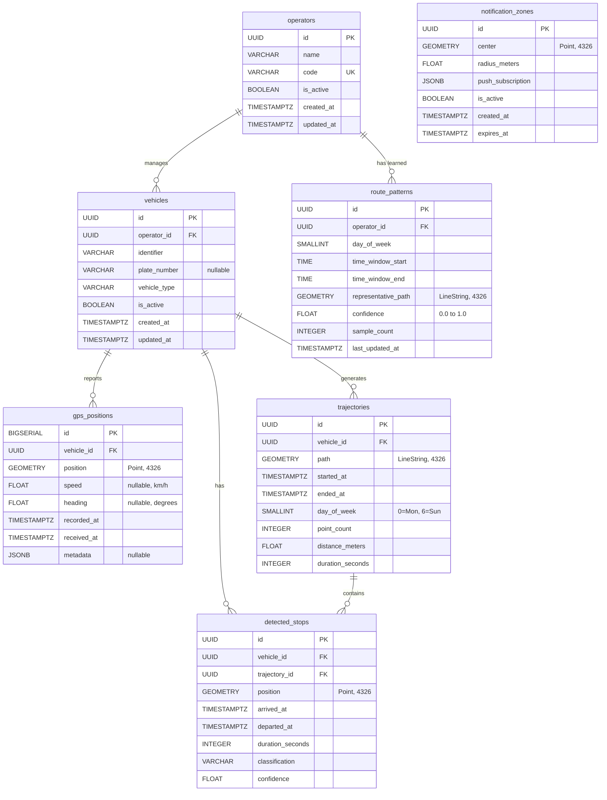

# Data Model

> **Document Status:** Living document — updated as the schema evolves.
>
> **Last Updated:** 2026-10-31

## Overview

KOLEKTA's data model is centered on **geospatial time-series data** — GPS positions from waste collection vehicles — and the analytical artifacts derived from that data (trajectories, detected stops, and route patterns). The model is designed for PostgreSQL with the PostGIS extension, leveraging spatial data types and spatial indexes throughout.

### Design Principles

| Principle | Description |
|---|---|
| **Spatial-first** | Geometry columns and spatial indexes are first-class citizens, not afterthoughts. |
| **Time-aware** | All temporal data uses `TIMESTAMPTZ` to avoid timezone ambiguity. |
| **Append-heavy** | GPS positions are append-only and high-volume; the schema is optimized for writes. |
| **Limited identity** | No named user accounts in MVP; opted-in notification zones pair a precise location with a push subscription and expire after 30 days. |
| **Extensible** | JSONB columns provide flexibility for device-specific metadata without schema changes. |

---

## Entity Relationship Diagram



---

## Entity Details

### `operators`

Represents a waste collection operator (company or municipal entity) that manages a fleet of vehicles.

| Column | Type | Constraints | Description |
|---|---|---|---|
| `id` | `UUID` | `PRIMARY KEY`, `DEFAULT gen_random_uuid()` | Unique operator identifier. |
| `name` | `VARCHAR(255)` | `NOT NULL` | Human-readable operator name. |
| `code` | `VARCHAR(50)` | `NOT NULL`, `UNIQUE` | Short code for API use and internal reference (e.g., `"op-example"`, `"op-norte"`). Do not use a real operator's name as the sample. KOLEKTA has no agreement with any operator. |
| `is_active` | `BOOLEAN` | `NOT NULL`, `DEFAULT TRUE` | Whether the operator is currently active in the system. |
| `created_at` | `TIMESTAMPTZ` | `NOT NULL`, `DEFAULT NOW()` | Record creation timestamp. |
| `updated_at` | `TIMESTAMPTZ` | `NOT NULL`, `DEFAULT NOW()` | Last modification timestamp. |

> [!NOTE]
> Operator records are manually provisioned. There is no self-registration — an operator must be set up by an administrator before their vehicles can report GPS data.

---

### `vehicles`

Represents a single waste collection vehicle belonging to an operator.

| Column | Type | Constraints | Description |
|---|---|---|---|
| `id` | `UUID` | `PRIMARY KEY`, `DEFAULT gen_random_uuid()` | Unique vehicle identifier in KOLEKTA. |
| `operator_id` | `UUID` | `NOT NULL`, `REFERENCES operators(id)` | The operator that manages this vehicle. |
| `identifier` | `VARCHAR(100)` | `NOT NULL` | The operator's internal identifier for this vehicle (e.g., fleet number). |
| `plate_number` | `VARCHAR(20)` | `NULLABLE` | License plate, if an operator provides it for their own operations. It is identifying operational data. Public and citizen-facing interfaces must not return it. |
| `vehicle_type` | `VARCHAR(50)` | `NOT NULL` | Type of collection vehicle. Allowed values: `compactor`, `open_truck`, `skip_loader`, `sweeper`, `other`. |
| `is_active` | `BOOLEAN` | `NOT NULL`, `DEFAULT TRUE` | Whether this vehicle is currently active. |
| `created_at` | `TIMESTAMPTZ` | `NOT NULL`, `DEFAULT NOW()` | Record creation timestamp. |
| `updated_at` | `TIMESTAMPTZ` | `NOT NULL`, `DEFAULT NOW()` | Last modification timestamp. |

**Unique constraint:** `(operator_id, identifier)` — a vehicle identifier is unique within an operator.

---

### `gps_positions`

Stores raw GPS position reports from vehicles. This is the **highest-volume table** in the system — expect millions of rows per month if multiple operators are reporting.

| Column | Type | Constraints | Description |
|---|---|---|---|
| `id` | `BIGSERIAL` | `PRIMARY KEY` | Auto-incrementing position identifier. `BIGSERIAL` used because `SERIAL` (32-bit) would overflow with high volumes. |
| `vehicle_id` | `UUID` | `NOT NULL`, `REFERENCES vehicles(id)` | The vehicle that reported this position. |
| `position` | `GEOMETRY(Point, 4326)` | `NOT NULL` | Geographic position in WGS84. |
| `speed` | `FLOAT` | `NULLABLE` | Speed in km/h as reported by the GPS device. |
| `heading` | `FLOAT` | `NULLABLE` | Compass heading in degrees (0–360) as reported by the GPS device. |
| `recorded_at` | `TIMESTAMPTZ` | `NOT NULL` | Timestamp from the GPS device when the position was recorded. |
| `received_at` | `TIMESTAMPTZ` | `NOT NULL`, `DEFAULT NOW()` | Timestamp when the KOLEKTA server received this position. |
| `metadata` | `JSONB` | `NULLABLE` | Additional device-specific data (e.g., satellite count, HDOP, battery level, ignition state). |

> [!IMPORTANT]
> `recorded_at` and `received_at` will differ due to network latency, device buffering, or connectivity gaps. Always use `recorded_at` for trajectory construction and `received_at` for data freshness monitoring.

**Example `metadata` payload:**

```json
{
  "satellites": 8,
  "hdop": 1.2,
  "ignition": true,
  "battery_pct": 85,
  "source": "traccar"
}
```

---

### `trajectories`

Aggregated from sequential `gps_positions` for a single vehicle within a continuous movement session. A trajectory represents one collection "trip" — the vehicle leaving a depot, performing collection, and returning.

| Column | Type | Constraints | Description |
|---|---|---|---|
| `id` | `UUID` | `PRIMARY KEY`, `DEFAULT gen_random_uuid()` | Unique trajectory identifier. |
| `vehicle_id` | `UUID` | `NOT NULL`, `REFERENCES vehicles(id)` | The vehicle that performed this trajectory. |
| `path` | `GEOMETRY(LineString, 4326)` | `NOT NULL` | Ordered sequence of GPS points forming the trajectory path. |
| `started_at` | `TIMESTAMPTZ` | `NOT NULL` | Timestamp of the first position in the trajectory. |
| `ended_at` | `TIMESTAMPTZ` | `NOT NULL` | Timestamp of the last position in the trajectory. |
| `day_of_week` | `SMALLINT` | `NOT NULL`, `CHECK (day_of_week BETWEEN 0 AND 6)` | Day of the week when the trajectory started. `0` = Monday, `6` = Sunday. ISO 8601 convention. |
| `point_count` | `INTEGER` | `NOT NULL` | Number of GPS positions that comprise this trajectory. |
| `distance_meters` | `FLOAT` | `NOT NULL` | Total path distance in meters (calculated via PostGIS `ST_Length` with geography cast). |
| `duration_seconds` | `INTEGER` | `NOT NULL` | Total duration from `started_at` to `ended_at`. |

**Segmentation rules** (proposed for a batch worker, not implemented):

- A new trajectory begins after a time gap. This document proposes 30 minutes. [Route Prediction](ROUTE_PREDICTION.md) proposes 10 minutes. The threshold is not decided.
- A new trajectory begins if the vehicle returns to a known depot location.
- Very short trajectories are excluded from pattern extraction. This document proposes discarding fewer than 5 points or under 100 meters. Route Prediction proposes storing segments under 3 points but excluding them from patterns. The rule is not decided.

---

### `route_patterns`

Learned patterns derived from clustering similar trajectories. These represent the system's understanding of "when and where does collection happen."

| Column | Type | Constraints | Description |
|---|---|---|---|
| `id` | `UUID` | `PRIMARY KEY`, `DEFAULT gen_random_uuid()` | Unique pattern identifier. |
| `operator_id` | `UUID` | `NOT NULL`, `REFERENCES operators(id)` | The operator whose trajectories produced this pattern. |
| `day_of_week` | `SMALLINT` | `NOT NULL`, `CHECK (day_of_week BETWEEN 0 AND 6)` | Day of the week this pattern applies to. |
| `time_window_start` | `TIME` | `NOT NULL` | Earliest typical start time for collection in this pattern. |
| `time_window_end` | `TIME` | `NOT NULL` | Latest typical end time for collection in this pattern. |
| `representative_path` | `GEOMETRY(LineString, 4326)` | `NOT NULL` | A representative path (medoid or centroid of the trajectory cluster). |
| `confidence` | `FLOAT` | `NOT NULL`, `CHECK (confidence BETWEEN 0.0 AND 1.0)` | Confidence score based on consistency and sample size. |
| `sample_count` | `INTEGER` | `NOT NULL` | Number of trajectories that contributed to this pattern. |
| `last_updated_at` | `TIMESTAMPTZ` | `NOT NULL`, `DEFAULT NOW()` | When this pattern was last recomputed. |

**Confidence scoring** (proposed heuristic):

| Factor | Impact |
|---|---|
| Sample count < 4 | Low confidence (< 0.3) |
| Sample count 4–10 | Medium confidence (0.3–0.7) |
| Sample count > 10 | High confidence baseline (0.7+) |
| Low spatial variance between trajectories | Increases confidence |
| High temporal variance (inconsistent timing) | Decreases confidence |
| Recent data (last 30 days) | Weighted higher than older data |

---

### `detected_stops`

Locations where a vehicle paused during a trajectory. These may indicate waste collection points, traffic delays, or driver breaks.

| Column | Type | Constraints | Description |
|---|---|---|---|
| `id` | `UUID` | `PRIMARY KEY`, `DEFAULT gen_random_uuid()` | Unique stop identifier. |
| `vehicle_id` | `UUID` | `NOT NULL`, `REFERENCES vehicles(id)` | The vehicle that stopped. |
| `trajectory_id` | `UUID` | `NOT NULL`, `REFERENCES trajectories(id)` | The trajectory during which this stop occurred. |
| `position` | `GEOMETRY(Point, 4326)` | `NOT NULL` | Geographic position of the stop (centroid of clustered low-speed points). |
| `arrived_at` | `TIMESTAMPTZ` | `NOT NULL` | When the vehicle arrived at the stop. |
| `departed_at` | `TIMESTAMPTZ` | `NOT NULL` | When the vehicle departed from the stop. |
| `duration_seconds` | `INTEGER` | `NOT NULL` | Stop duration in seconds. |
| `classification` | `VARCHAR(50)` | `NOT NULL`, `DEFAULT 'unknown'` | Proposed labels: `possible_collection`, `likely_collection`, `traffic`, `depot`, `unknown`. [Route Prediction](ROUTE_PREDICTION.md) used `traffic_stop` for the same idea as `traffic`. Use the names in this table. `likely_collection` still means an inference, not a confirmed collection. |
| `confidence` | `FLOAT` | `NOT NULL`, `CHECK (confidence BETWEEN 0.0 AND 1.0)` | Confidence in the classification. |

**Stop detection criteria** (implemented in the Python worker):

- Speed below threshold (proposed: < 3 km/h) for a minimum duration (proposed: > 30 seconds).
- Cluster nearby low-speed points into a single stop event.
- Classify based on duration, location context (e.g., proximity to known depot), and recurrence.

---

### `notification_zones` (MVP — Opt-In Background Notifications)

> [!IMPORTANT]
> **Included in MVP under [PD-009](PRODUCT_DECISIONS.md#pd-009-server-side-citizen-locations-for-background-notifications).** A zone is written only after the citizen opts in to background notifications. It stores the chosen location and push subscription for up to 30 days, and is deleted when the citizen unsubscribes.

| Column | Type | Constraints | Description |
|---|---|---|---|
| `id` | `UUID` | `PRIMARY KEY`, `DEFAULT gen_random_uuid()` | Unique zone identifier. |
| `center` | `GEOMETRY(Point, 4326)` | `NOT NULL` | Center point of the notification zone. |
| `radius_meters` | `FLOAT` | `NOT NULL` | Radius of the notification zone (50–2000 m). |
| `push_subscription` | `JSONB` | `NOT NULL` | Web Push API subscription object (endpoint, keys). |
| `is_active` | `BOOLEAN` | `NOT NULL`, `DEFAULT TRUE` | Whether notifications are currently enabled for this zone. |
| `created_at` | `TIMESTAMPTZ` | `NOT NULL`, `DEFAULT NOW()` | When the zone was created. |
| `expires_at` | `TIMESTAMPTZ` | `NOT NULL` | 30 days after creation; expired rows are deleted by a scheduled job. |

---

## Indexing Strategy

### Spatial Indexes (GiST)

All geometry columns use GiST (Generalized Search Tree) indexes for efficient spatial queries:

```sql
CREATE INDEX idx_gps_positions_position ON gps_positions USING GIST (position);
CREATE INDEX idx_trajectories_path ON trajectories USING GIST (path);
CREATE INDEX idx_route_patterns_representative_path ON route_patterns USING GIST (representative_path);
CREATE INDEX idx_detected_stops_position ON detected_stops USING GIST (position);
CREATE INDEX idx_notification_zones_center ON notification_zones USING GIST (center);
```

### Time-Based Indexes

```sql
-- Critical for trajectory construction queries
CREATE INDEX idx_gps_positions_vehicle_recorded
    ON gps_positions (vehicle_id, recorded_at DESC);

-- For monitoring data freshness
CREATE INDEX idx_gps_positions_received_at
    ON gps_positions (received_at DESC);

-- For trajectory time-range queries
CREATE INDEX idx_trajectories_started_at
    ON trajectories (started_at DESC);
```

### Composite and Filtered Indexes

```sql
-- Route pattern lookups by operator and day
CREATE INDEX idx_route_patterns_operator_day
    ON route_patterns (operator_id, day_of_week);

-- Active notification zones only (filtered index)
CREATE INDEX idx_notification_zones_active
    ON notification_zones (is_active)
    WHERE is_active = TRUE;

-- Active vehicles only
CREATE INDEX idx_vehicles_active
    ON vehicles (operator_id)
    WHERE is_active = TRUE;
```

### Table Partitioning (gps_positions)

The `gps_positions` table should be partitioned by time range to manage its growth:

```sql
-- Partition by month on recorded_at
CREATE TABLE gps_positions (
    id BIGSERIAL,
    vehicle_id UUID NOT NULL,
    position GEOMETRY(Point, 4326) NOT NULL,
    speed FLOAT,
    heading FLOAT,
    recorded_at TIMESTAMPTZ NOT NULL,
    received_at TIMESTAMPTZ NOT NULL DEFAULT NOW(),
    metadata JSONB,
    PRIMARY KEY (id, recorded_at)
) PARTITION BY RANGE (recorded_at);

-- Create monthly partitions
CREATE TABLE gps_positions_2026_10
    PARTITION OF gps_positions
    FOR VALUES FROM ('2026-10-01') TO ('2026-11-01');

CREATE TABLE gps_positions_2026_11
    PARTITION OF gps_positions
    FOR VALUES FROM ('2026-11-01') TO ('2026-12-01');
```

> [!TIP]
> Use `pg_partman` to automate partition creation and maintenance. It can create future partitions ahead of time and optionally detach or drop old partitions based on a retention policy.

---

## Data Retention

| Data Type | Retention Policy | Rationale |
|---|---|---|
| **Raw GPS positions** | 90 days, then drop or archive | High volume; older data is captured in trajectories. |
| **Trajectories** | Indefinite | Aggregated and compact; essential for pattern learning. |
| **Route patterns** | Indefinite (updated regularly) | Core analytical output; small footprint. |
| **Detected stops** | Indefinite | Useful for historical analysis and pattern validation. |
| **Notification zones** | Up to 30 days; delete earlier on unsubscribe | Supports background push; expired records are purged by a scheduled job. |

### Archival Strategy

- Expired `gps_positions` partitions can be detached and exported to compressed Parquet files for cold storage.
- A scheduled job (cron or pg_cron) should run weekly to:
    - Drop or detach partitions older than the retention window.
    - Deactivate and delete expired `notification_zones`.
    - Log retention actions for audit purposes.

---

## PostGIS Considerations

### Coordinate Reference System

All coordinates are stored in **WGS84 (SRID 4326)**, the standard GPS coordinate system. This means:

- Coordinates are in `(longitude, latitude)` order in PostGIS (note: this is the opposite of the common `(lat, lng)` convention used in many GPS devices and web mapping APIs).
- Distance calculations using the `geometry` type return degrees, not meters. For accurate distance calculations, cast to `geography`:

```sql
-- Distance in meters between two points
SELECT ST_Distance(
    position::geography,
    ST_SetSRID(ST_MakePoint(13.23, -8.84), 4326)::geography
) AS distance_meters
FROM gps_positions;
```

### Geometry vs. Geography Types

| Use Case | Recommended Type | Reason |
|---|---|---|
| Storage of positions and paths | `GEOMETRY(Point/LineString, 4326)` | Faster spatial operations, smaller storage |
| Distance calculations | Cast to `GEOGRAPHY` at query time | Accurate meter-based distances on the ellipsoid |
| Proximity queries (ST_DWithin) | Cast to `GEOGRAPHY` | Correct radius in meters |
| Spatial joins and intersections | `GEOMETRY` | Better performance with GiST indexes |

### Luanda-Specific Spatial Bounds

For data validation, positions should be checked against Luanda's approximate bounding box:

```sql
-- Luanda bounding box (approximate, generous)
-- Latitude:  -9.05 to -8.65
-- Longitude: 13.05 to 13.55

SELECT ST_MakeEnvelope(13.05, -9.05, 13.55, -8.65, 4326) AS luanda_bounds;

-- Validate a position is within bounds
SELECT ST_Within(
    position,
    ST_MakeEnvelope(13.05, -9.05, 13.55, -8.65, 4326)
) AS is_valid
FROM gps_positions;
```

> [!NOTE]
> These bounds are approximate and intentionally generous. They should be refined based on actual operator service areas once GPS data is available.

---

## Privacy Considerations

### No User Account in the MVP

The MVP does not implement user accounts. The `notification_zones` table, as drawn, stores:

- A geographic point (where the citizen is interested in collection activity).
- A push subscription (a browser-generated endpoint for Web Push notifications).

There is no name, email, phone number, or driver identity. A precise point can still identify a household, and the push subscription links that point to a browser instance. Treat both fields as sensitive even without a named account. Under [PD-009](PRODUCT_DECISIONS.md#pd-009-server-side-citizen-locations-for-background-notifications), a zone is created only after opt-in, retained for up to 30 days, and deleted on unsubscribe or expiry.

There is no `predictions` table and no `vehicle_latest_position` table. Latest position is "the newest `gps_positions` row for that vehicle", which is an observation. Passage estimates are a different artefact (`route_patterns`, and any future prediction record). Do not overwrite an observation with an estimate.

[Route Prediction](ROUTE_PREDICTION.md) also describes trips and route templates. Those names are not extra tables unless a later decision says so. For now, `trajectories` and `route_patterns` are the entities in this document.

### Who can read what

These rows restate the documents as they are. They are not a completed access policy.

| Data | Citizen-facing API | Operator or admin | Conflict |
|---|---|---|---|
| Latest vehicle position | Public, no account ([API](API_SPECIFICATION.md)) | Own fleet, later | Public display needs operator consent. No agreement exists. |
| Current-trip trajectory | Public in the API draft | Not separately defined | The privacy text below says citizens do not receive historical raw paths. A current-trip line is more than a point. Unresolved. |
| Raw `gps_positions` history | Not a citizen endpoint | Own vehicles only; mechanism pending | — |
| `plate_number` and any driver identity | Never | Not defined | The column exists. No API may add it to a public response without a new decision. |
| `notification_zones` and push keys | Create/delete through unguessable subscription ID; no listing or read endpoint | Notification worker only | Stored for up to 30 days; restrict service access and purge on unsubscribe or expiry. |
| Passage predictions | Public estimates, with confidence | Future analytics | Must stay labelled as estimates. |

### Push Subscription Data

The `push_subscription` JSONB column contains a Web Push API subscription object:

```json
{
  "endpoint": "https://fcm.googleapis.com/fcm/send/...",
  "keys": {
    "p256dh": "...",
    "auth": "..."
  }
}
```

This data should be treated as **sensitive** because:

- The endpoint URL could theoretically be used to send unwanted notifications (though content would be encrypted).
- The subscription is tied to a specific browser instance and could be used for fingerprinting.

**Mitigations:**

- Do not expose push subscription data via any API endpoint.
- Purge expired notification zones promptly.
- Encrypt the `push_subscription` column at the application level if feasible. ⏳ [PENDING] decision.

### GPS Data Sensitivity

Raw GPS data reveals operational patterns of waste collection operators:

- Routes, timing, frequency, and coverage gaps.
- Vehicle utilization and idle time.

**Mitigations:**

- Restrict raw GPS data API access to authenticated operator accounts.
- The stated intent is that citizen-facing APIs expose current vehicle positions and aggregated patterns, not a historical dump of raw points. The public current-trip trajectory endpoint is broader than that intent and is unresolved. See the access table above.
- Consider operator-level data isolation if multiple operators share the system.
- ⏳ [PENDING] — Data sharing agreements with operators must define what data can be made public.

### Regulatory Compliance

- ⏳ [PENDING] — Identify applicable data protection regulations in Angola (e.g., Lei de Protecção de Dados Pessoais).
- Provide a self-service unsubscribe flow that deletes a notification zone and its push subscription without requiring a user account.

---

## Cross-References

| Document | Relevance |
|---|---|
| [System Architecture](SYSTEM_ARCHITECTURE.md) | Overall system design and component interactions |
| [GPS Integration](GPS_INTEGRATION.md) | How GPS data enters the `gps_positions` table |
| [Route Prediction](ROUTE_PREDICTION.md) | How trajectories are processed into route patterns |
| [API Specification](API_SPECIFICATION.md) | API endpoints that read from and write to this data model |
