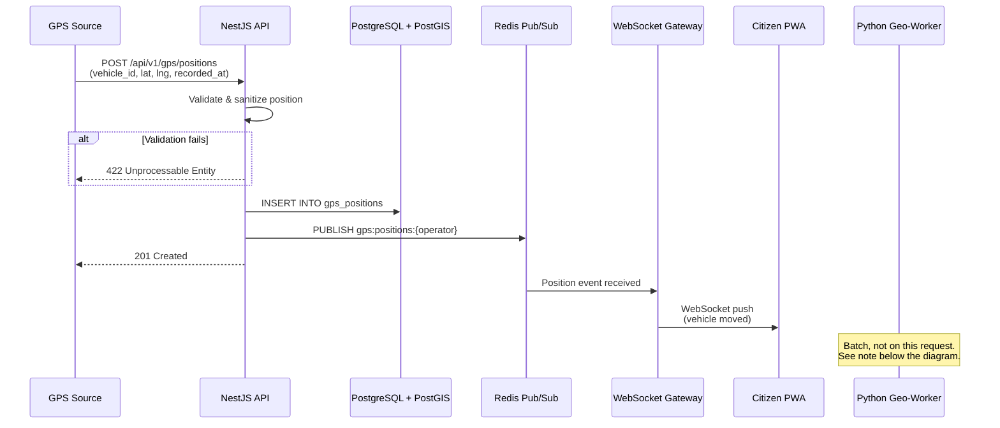
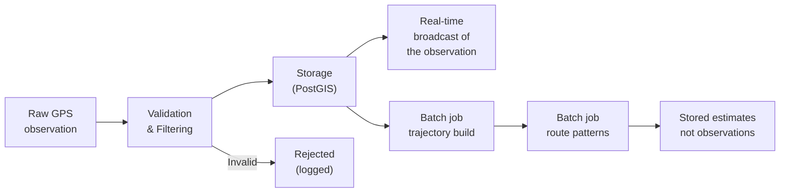

# GPS Integration

> **Document Status:** Living document — will be updated significantly once GPS data sources are confirmed.
>
> **Last Updated:** 2026-10-31

## Overview

KOLEKTA depends on GPS data from waste collection vehicles operating in Luanda, Angola. The system must receive vehicle positions in near-real-time, validate and store them, broadcast updates to connected clients, and feed them into the geospatial processing pipeline for trajectory analysis and route pattern learning.

The initial GPS integration strategy is designed to be **flexible and source-agnostic** because the specific data sources have not yet been confirmed.

> [!WARNING]
> **No GPS data source agreements are currently in place.** This document describes the planned integration architecture, not confirmed integrations. All data source descriptions below are possibilities being evaluated — none have been agreed upon with any operator or third party.

---

## Possible GPS Data Sources

The system is designed to accept data from any of the following sources. The ingestion API provides a common interface regardless of the upstream source.

### 1. Operator Fleet Management Systems

Many waste collection operators use fleet management platforms (e.g., commercial GPS tracking services) to monitor their vehicles. If an operator grants API access to their fleet management system, KOLEKTA could pull or receive position data via that system's API.

| Aspect | Detail |
|---|---|
| **Likelihood** | Medium — depends on operator willingness and their platform's API availability. |
| **Integration effort** | Medium — requires building an adapter per platform. |
| **Data quality** | Typically high — commercial systems provide filtered, validated positions. |
| **Requirements** | Formal data-sharing agreement with the operator; API credentials. |

### 2. Dedicated GPS Tracking Devices

Low-cost GPS/GPRS tracking devices (e.g., Queclink, Teltonika, Concox) could be installed on vehicles with operator permission. These devices report positions via cellular networks to a configured server endpoint.

| Aspect | Detail |
|---|---|
| **Likelihood** | Medium — requires physical device installation and cellular connectivity costs. |
| **Integration effort** | Medium-High — device protocols vary; a protocol adapter (e.g., Traccar) may be needed. |
| **Data quality** | Good — purpose-built hardware with dedicated GPS antennas. |
| **Requirements** | Operator permission for installation; ongoing SIM card / data costs; device procurement. |

### 3. Mobile Phone GPS (Driver App)

A lightweight mobile application installed on drivers' smartphones could transmit GPS positions to KOLEKTA. This is the **simplest deployment option** but depends on driver cooperation and phone availability.

| Aspect | Detail |
|---|---|
| **Likelihood** | High for prototyping — smartphones are ubiquitous, no hardware procurement needed. |
| **Integration effort** | Low — a simple Android app or even a PWA with Geolocation API. |
| **Data quality** | Variable — phone GPS accuracy varies, battery optimization may throttle updates, driver may forget to activate. |
| **Requirements** | Driver willingness; a phone with GPS and data connectivity; app development. The app must send a vehicle identifier and positions only. It must not collect or transmit driver name, phone number, account, or device-owner identity. |

### 4. Third-Party Fleet Tracking Platforms (e.g., Traccar)

Open-source platforms like [Traccar](https://www.traccar.org/) support hundreds of GPS device protocols and can act as an intermediary, normalizing device data into a standard format that KOLEKTA can consume.

| Aspect | Detail |
|---|---|
| **Likelihood** | High as a technical intermediary — Traccar is free, open-source, and well-documented. |
| **Integration effort** | Low — Traccar provides a REST API and supports webhooks/event forwarding. |
| **Data quality** | Depends on the upstream devices — Traccar normalizes but doesn't improve raw GPS quality. |
| **Requirements** | Traccar server deployment; device configuration to report to Traccar. |

> [!TIP]
> The Traccar approach is particularly attractive because it decouples KOLEKTA from specific GPS device protocols. Traccar handles protocol parsing for 1,500+ device types, and KOLEKTA only needs to integrate with Traccar's clean REST/webhook API.

---

## GPS Data Ingestion Architecture

### Sequence Diagram



> [!IMPORTANT]
> The ingestion request ends when the observation is stored and published for live display. Trajectory construction, stop detection, and route-pattern updates do not run inside that request. [FR-S03](PRODUCT_REQUIREMENTS.md) requires pattern detection as a batch job. Stop detection is post-MVP ([FR-S06](PRODUCT_REQUIREMENTS.md)). An earlier draft of this diagram updated trajectories, stops, and patterns on the same path as ingestion. That mixed GPS observations with prediction and has been removed.

### Processing Pipeline



Stop detection is omitted here because it is post-MVP. It must not sit on the ingestion path.

---

## Ingestion API Design

### Single Position Endpoint

```
POST /api/v1/gps/positions
```

**Headers:**

| Header | Required | Description |
|---|---|---|
| `Authorization` | Yes | `Bearer <api_key>` — operator-specific API key |
| `Content-Type` | Yes | `application/json` |

**Request Body:**

```json
{
  "vehicle_id": "a1b2c3d4-e5f6-7890-abcd-ef1234567890",
  "latitude": -8.8383,
  "longitude": 13.2344,
  "recorded_at": "2026-10-31T14:30:00Z",
  "speed": 25.5,
  "heading": 180.0,
  "metadata": {
    "satellites": 8,
    "hdop": 1.2
  }
}
```

**Fields:**

| Field | Type | Required | Description |
|---|---|---|---|
| `vehicle_id` | UUID | Yes | Vehicle identifier (must exist in the `vehicles` table and belong to the authenticated operator). |
| `latitude` | Float | Yes | Latitude in decimal degrees (WGS84). |
| `longitude` | Float | Yes | Longitude in decimal degrees (WGS84). |
| `recorded_at` | ISO 8601 | Yes | Timestamp when the GPS device recorded the position. |
| `speed` | Float | No | Speed in km/h. |
| `heading` | Float | No | Compass heading in degrees (0–360). |
| `metadata` | Object | No | Additional device-specific data. |

**Responses:**

| Status | Meaning |
|---|---|
| `201 Created` | Position accepted and stored. |
| `400 Bad Request` | Malformed JSON or missing required fields. |
| `401 Unauthorized` | Missing or invalid API key. |
| `403 Forbidden` | API key does not have permission for this vehicle. |
| `422 Unprocessable Entity` | Validation failed (out-of-bounds coordinates, unreasonable timestamp, etc.). |
| `429 Too Many Requests` | Rate limit exceeded. |

### Batch Endpoint

```
POST /api/v1/gps/positions/batch
```

Accepts an array of positions for bulk import (e.g., backfilling historical data from a fleet management system, or buffered positions from a device that was offline).

**Request Body:**

```json
{
  "positions": [
    {
      "vehicle_id": "a1b2c3d4-e5f6-7890-abcd-ef1234567890",
      "latitude": -8.8383,
      "longitude": 13.2344,
      "recorded_at": "2026-10-31T14:30:00Z",
      "speed": 25.5
    },
    {
      "vehicle_id": "a1b2c3d4-e5f6-7890-abcd-ef1234567890",
      "latitude": -8.8390,
      "longitude": 13.2350,
      "recorded_at": "2026-10-31T14:30:15Z",
      "speed": 22.0
    }
  ]
}
```

| Constraint | Value |
|---|---|
| Maximum positions per batch | 1,000 (proposed) |
| Positions must belong to | Vehicles under the authenticated operator |
| Ordering | Not required — server sorts by `recorded_at` |

**Response:** Returns a summary indicating how many positions were accepted, rejected, and any per-position errors.

```json
{
  "accepted": 998,
  "duplicates_ignored": 1,
  "rejected": 1,
  "errors": [
    { "index": 42, "error": "latitude out of bounds" }
  ]
}
```

Duplicates are not errors. They are ignored, as described under duplicate detection below.

---

## Data Validation Rules

Every incoming GPS position is validated before storage. Positions that fail validation are **rejected with a descriptive error** and optionally logged for diagnostic purposes.

### Coordinate Bounds

Positions must fall within a generous bounding box around Luanda:

| Bound | Value |
|---|---|
| Minimum latitude | -9.05 |
| Maximum latitude | -8.65 |
| Minimum longitude | 13.05 |
| Maximum longitude | 13.55 |

Positions outside these bounds are rejected. The bounds are intentionally generous to accommodate vehicles operating in Luanda's peri-urban areas.

> [!NOTE]
> These bounds should be configurable and may need adjustment as the service area is better understood. They could eventually be replaced with a proper service area polygon.

### Timestamp Validation

| Rule | Action |
|---|---|
| Timestamp is in the future (> server time + 5 minutes) | Reject |
| Timestamp is older than 7 days | Reject (or route to batch endpoint for historical import) |
| Timestamp format is not ISO 8601 | Reject |
| Timestamp missing timezone information | Reject (ambiguous) |

### Duplicate Detection

A position is considered a duplicate if all of the following match an existing record:

- Same `vehicle_id`
- Same `recorded_at` timestamp (within 1-second tolerance)
- Same coordinates (within ~1 meter tolerance)

Duplicates are silently ignored (idempotent ingestion) and return `201 Created` without creating a new record.

### Speed and Heading Validation

| Rule | Action |
|---|---|
| Speed < 0 | Reject |
| Speed > 200 km/h | Flag as suspicious (waste trucks should not exceed ~80 km/h) |
| Heading < 0 or > 360 | Reject |

### Calculated Validation (Post-Ingestion)

These checks are performed after insertion, comparing the new position to the vehicle's previous position:

| Check | Threshold | Action |
|---|---|---|
| **Teleportation** — distance between consecutive points too large for the elapsed time | > 200 km/h implied speed | Flag position for review |
| **Stale data** — no new positions from a vehicle | > 10 minutes (configurable) | Mark vehicle as offline in real-time status |

---

## Data Quality Considerations

GPS data in Luanda presents specific quality challenges:

### Urban Canyon Effects

Luanda's dense urban areas (especially Baixa de Luanda, Maianga, and parts of Sambizanga) have multi-story buildings that can cause GPS signal reflection and multipath errors. Expected impact:

- Position accuracy may degrade from ~3m to 15–30m in dense areas.
- Sudden position jumps ("GPS drift") may occur.
- Mitigation is not chosen. [Route Prediction](ROUTE_PREDICTION.md) proposes a short moving average during trajectory construction. Kalman filtering is not part of that method and must not be described as current behaviour.

### Network Connectivity Gaps

Cellular network coverage in Luanda, while generally available in urban areas, may have gaps in peri-urban zones. Expected impact:

- Devices may buffer positions and transmit them in batches when connectivity is restored.
- The batch ingestion endpoint accommodates this pattern.
- `received_at` timestamps will show gaps even if `recorded_at` timestamps are continuous.

### Device-Specific Issues

| Issue | Description | Mitigation |
|---|---|---|
| **Cold start** | First positions after device power-on may be inaccurate (satellite acquisition). | Discard first N positions or positions with low satellite count (if available in metadata). |
| **Clock drift** | Device clocks may drift, especially on low-cost hardware. | Cross-reference with `received_at`; flag positions where the delta exceeds a threshold. |
| **Zero-zero positions** | Some devices report `(0, 0)` when they have no fix. | Bounds checking rejects these. |
| **Stuck positions** | Device reports the same position repeatedly despite movement. | Detect and flag in post-ingestion analysis. |

---

## Coordinate System

All GPS data in KOLEKTA uses **WGS84 (EPSG:4326)**, the standard coordinate reference system used by GPS devices worldwide.

### Conventions

| Convention | KOLEKTA Standard |
|---|---|
| Coordinate order (API) | `latitude, longitude` (consistent with most GPS devices and web APIs) |
| Coordinate order (PostGIS) | `longitude, latitude` (PostGIS convention — `ST_MakePoint(lng, lat)`) |
| Coordinate unit | Decimal degrees |
| Altitude | Not stored (not needed for ground-level vehicle tracking) |
| SRID | 4326 |

> [!IMPORTANT]
> The API accepts `latitude, longitude` (the human-friendly convention), but PostGIS stores and operates on `longitude, latitude`. The backend must perform this transposition when inserting data and when reading data for API responses.

### Luanda Reference Points

For testing and validation purposes, these are approximate coordinates for key Luanda locations:

| Location | Latitude | Longitude |
|---|---|---|
| Marginal de Luanda (waterfront) | -8.8108 | 13.2319 |
| Largo da Independência | -8.8147 | 13.2344 |
| Mercado do Kikolo | -8.8483 | 13.3122 |
| Aeroporto 4 de Fevereiro | -8.8583 | 13.2314 |
| Viana (peri-urban) | -8.9036 | 13.3778 |

---

## Privacy and Security

### Operational Data Sensitivity

GPS data reveals operational patterns of waste collection operators — routes, timing, frequency, coverage gaps, and vehicle utilization. This information:

- May be commercially sensitive to operators.
- Could be used to evaluate operator performance (which may be politically sensitive).
- Should be treated as **confidential per operator** unless the operator explicitly agrees to make it public.

### Security Measures

| Measure | Description |
|---|---|
| **HTTPS only** | GPS ingestion API endpoints only accept HTTPS connections. HTTP requests are rejected, not redirected. |
| **API key authentication** | Each operator receives a unique API key. Keys are hashed and stored — never logged or returned after initial creation. |
| **IP allowlisting** | ⏳ [PENDING] — Consider restricting GPS ingestion to known IP addresses per operator. |
| **Rate limiting** | Per-API-key rate limits prevent abuse and accidental data floods. |
| **Audit logging** | All GPS data access (reads of raw position data) is logged with the accessor's identity and timestamp. |
| **Data isolation** | ⏳ [PENDING] — Consider row-level security in PostgreSQL to ensure operators can only access their own vehicles' data via admin APIs. |

### API Key Management

- ⏳ [PENDING] — Detailed API key lifecycle (creation, rotation, revocation).
- Keys should have configurable permissions (e.g., a key that can only submit data for specific vehicles).
- Keys must be transmitted only over HTTPS.
- Consider short-lived tokens (JWT) instead of long-lived API keys for enhanced security.

---

## Expected Data Volumes

These are rough estimates to guide infrastructure sizing. Actual volumes depend on the number of operators, vehicles, and GPS update frequency.

| Parameter | Estimate | Notes |
|---|---|---|
| Vehicles per operator | 10–100 | Highly variable |
| GPS update frequency | 1 position per 5–30 seconds | Depends on device and configuration |
| Positions per vehicle per day | 2,880–17,280 | Assuming 8-hour operating window |
| Positions per day (50 vehicles, 15s interval) | ~96,000 | Moderate scenario |
| Positions per month (50 vehicles, 15s interval) | ~2.9 million | Storage and indexing implications |
| Position row size (estimated) | ~200 bytes | Including geometry and indexes |
| Monthly storage (50 vehicles, 15s interval) | ~580 MB raw | Before indexes and overhead |

> [!NOTE]
> These are planning estimates, not measured values. Actual volumes will be known only after GPS data sources are established.

---

## Pending Decisions

| Decision | Context | Impact |
|---|---|---|
| ⏳ Which GPS data source(s) will be used initially | Determines integration effort and device procurement needs | High — blocks GPS integration development |
| ⏳ Authentication mechanism for GPS ingestion API | API keys vs. JWT vs. OAuth2 client credentials | Medium — affects security architecture |
| ⏳ GPS update frequency requirements | Affects data volume, storage costs, and real-time responsiveness | Medium |
| 📋 Data sharing agreements with operators | Draft template ready: see [Operator Data Agreement](OPERATOR_DATA_AGREEMENT_TEMPLATE.md) | High — required before production operator data reception |
| ⏳ Whether to support the Traccar protocol natively | Could simplify integration with many GPS device types | Low — can be added later |
| ⏳ IP allowlisting for GPS sources | Additional security layer | Low |
| ⏳ Row-level security for multi-operator data isolation | Ensures operators cannot access each other's data | Medium |
| ⏳ Historical data import requirements | Affects batch endpoint design and initial trajectory analysis | Low |

---

## Cross-References

| Document | Relevance |
|---|---|
| [System Architecture](SYSTEM_ARCHITECTURE.md) | Where GPS ingestion fits in the overall system |
| [Data Model](DATA_MODEL.md) | Schema for `gps_positions`, `vehicles`, and `operators` tables |
| [Route Prediction](ROUTE_PREDICTION.md) | How GPS data is processed into predictions |
| [API Specification](API_SPECIFICATION.md) | Full API contract for the GPS ingestion endpoints |
