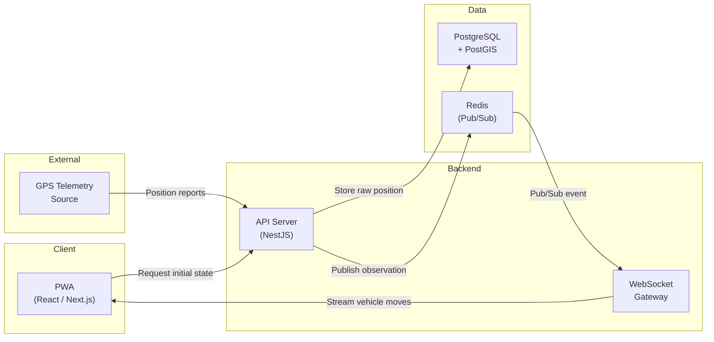

# KOLEKTA — MVP Scope

This document defines the boundary of the Minimum Viable Product (MVP) for KOLEKTA, formally approved under [PD-010](PRODUCT_DECISIONS.md#pd-010-mvp-scope-definition--option-a-live-tracking--proximity-only) as **Option A: Live Tracking & Proximity Alerts**. The MVP is the leanest release that demonstrates the core value proposition and validates the telemetry pipeline under real-world conditions.

---

## MVP Goal

> **Demonstrate the core value proposition:** a citizen can view active waste collection vehicles near their location on a map in real time and receive a proximity alert when a vehicle approaches.

The MVP proves that GPS ingestion, real-time spatial processing, and citizen visibility are technically robust, useful, and viable as the operational foundation before adding historical predictive modeling.

---

## MVP Includes

### Citizen Experience

| Capability | Requirement Ref | Notes |
|---|---|---|
| **Interactive vehicle map** | FR-C01 | MapLibre + OpenStreetMap. Shows real-time positions of active collection vehicles. |
| **Set location (GPS or pin)** | FR-C02 | Citizen selects location via device GPS or manual pin. A zone is stored for up to 30 days only after opt-in to background notifications. |
| **See nearby vehicles** | FR-C03 | Vehicles within a configurable spatial radius are highlighted. |
| **Proximity alerts** | FR-C04 (MVP) | In-session alerts and opt-in background push when a vehicle enters the citizen's proximity radius. |
| **Vehicle status** | FR-C07 (basic) | Active / Returning / Idle status inferred from live telemetry (speed, heading, movement). |
| **Mobile-responsive PWA** | NFR-07 | Installable on home screen. Displays map and real-time state with offline indicators. |

### System & Backend

| Capability | Requirement Ref | Notes |
|---|---|---|
| **GPS data ingestion** | FR-S01 | REST API endpoint accepting vehicle position reports (`POST /api/v1/gps/positions`). |
| **Telemetry storage** | FR-S02 | PostgreSQL + PostGIS storage of raw GPS positions with spatial indexes. |
| **Real-time updates** | — | WebSocket gateway broadcasting vehicle movements via Redis Pub/Sub. |
| **Notification zones** | PD-009 | Store opted-in coordinates, radius, and push subscription for up to 30 days; delete on unsubscribe or expiry. |

### Infrastructure

| Capability | Notes |
|---|---|
| **Single-operator scope** | The MVP integrates one waste collection operator (or simulated test feed). Multi-operator schema prepared. |
| **Containerised deployment** | Full stack runs via `docker compose` for local development and staging. |
| **Portuguese interface** | Primary UI language is Portuguese. Internationalization architecture in place. |

---

## MVP Excludes (Deferred to Later Phases)

The following capabilities are intentionally **out of scope** for the MVP. They are planned for future phases as described in the [Roadmap](ROADMAP.md).

| Excluded Capability | Requirement Ref | Phase | Reason for Deferral |
|---|---|---|---|
| **Trajectory construction & segmentation** | FR-S02 (pipeline) | Phase 2 | Batch pipeline requires accumulated operational data to segment trips cleanly. |
| **Route pattern detection** | FR-S03 | Phase 2 | Meaningful patterns require weeks of continuous historical telemetry. |
| **Passage time predictions** | FR-C06, FR-S04 | Phase 2 | Cannot estimate arrival windows without established historical route templates. |
| **Live vs. predicted route comparison** | FR-S05 | Phase 2 | Depends on active prediction engine. |
| **Collection stop detection** | FR-C05, FR-S06 | Phase 2 | Stopping heuristics require data calibration to prevent false positives. |
| **Prediction invalidation** | FR-S07 | Phase 2 | Depends on live route comparison. |
| **Operator fleet dashboard** | FR-O01, FR-O02 | Phase 3 | Operator portal deferred until operator data agreements are finalized. |
| **Multi-operator live routing** | FR-S08 | Phase 3 | Multi-operator schema exists, but operational verification begins with one operator. |
| **User accounts & authentication** | — | Phase 3+ | Avoids login friction; background notification zones remain pseudonymous and linked to a push subscription. |
| **Native mobile apps** | — | Phase 4 | PWA satisfies mobile requirements without cross-platform overhead. |

---

## MVP Architecture Summary

The MVP uses a simplified version of the full system architecture:

> [!NOTE]
> This is the logical architecture for MVP (Phase 1: Live Tracking & Proximity). The Python pattern worker and predictive engine are introduced in Phase 2. See [System Architecture](SYSTEM_ARCHITECTURE.md) for the full architecture.

---

## MVP Success Criteria

The MVP is considered successful when all of the following are demonstrably true:

### 1. Core User Journey Works

> A citizen can open the KOLEKTA web application, set their location on the map, and see the real-time positions of nearby active collection vehicles.

- The map loads and displays OpenStreetMap tiles for Luanda.
- Vehicle icons appear on the map and update in near-real-time as GPS telemetry arrives.
- The citizen's location is shown on the map after GPS or manual selection. It stays client-side unless the citizen opts in to background notifications.

### 2. Proximity Alert Delivered

> A citizen receives an alert when a collection vehicle enters the proximity radius around their set location.

- The alert is triggered when an active vehicle crosses the configured proximity threshold.
- The alert displays clear information (e.g., "A collection truck is within 500m of your location").
- With background notifications enabled, the server stores the selected zone and push subscription for up to 30 days. The citizen can disable notifications and delete the stored zone at any time.

### 3. Reliable Ingestion & Real-Time Telemetry Pipeline

> The backend correctly ingests, validates, and persists incoming vehicle telemetry and broadcasts positions with low latency.

- GPS positions are ingested via `POST /api/v1/gps/positions`, validated, and stored in PostGIS.
- Incoming positions are broadcast to active WebSocket clients within 5 seconds of receipt.
- Telemetry data is clean and indexed for subsequent Phase 2 trajectory reconstruction.

### 4. Reliable Containerised Operation

> The system runs reliably in a containerised local environment.

- The MVP stack (frontend, backend, database, Redis) runs via `docker compose`.
- The system operates stably over a multi-hour test period without crashes or data loss.
- The system recovers gracefully from simulated transient failures (e.g., database restart).

---

## What the MVP Is NOT

To set expectations clearly:

- **The MVP is not a production-ready public service.** It is a functional proof of concept suitable for demonstration and validation.
- **The MVP does not require real operator data.** It can be validated using simulated GPS data that mimics realistic collection vehicle behaviour.
- **The MVP does not cover all of Luanda.** It demonstrates capability, not coverage.
- **The MVP does not guarantee prediction accuracy.** Pattern detection with limited data will produce rough estimates. This is expected and acceptable.

---

*Cross-reference: [Product Requirements](PRODUCT_REQUIREMENTS.md) · [Roadmap](ROADMAP.md) · [Product Decisions](PRODUCT_DECISIONS.md) · [System Architecture](SYSTEM_ARCHITECTURE.md)*
