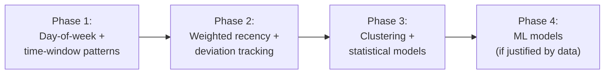

# KOLEKTA — Product Decisions Log

This document records key product and technical decisions for the KOLEKTA project. Each decision is documented with its context, rationale, alternatives considered, and consequences.

**Decision Statuses:**
- ✅ **APPROVED** — Decision made and adopted.
- 📋 **PROPOSED** — Decision recommended but open to community discussion.
- ⏳ **PENDING** — Decision requires further analysis or founder approval.

> [!NOTE]
> Dates in this log are labels written into the foundation draft. The Git repository has no earlier history that confirms them. Do not treat a date here as an audited decision record.
>
> Claims such as namespace searches, operator facts, or technology comparisons are only as strong as the text in this file. Where no source is cited, the claim is unverified.

---

## PD-001: Project Name "KOLEKTA"

| Field | Detail |
|---|---|
| **Status** | ✅ APPROVED |
| **Date** | 2025-01 |
| **Category** | Brand / Identity |

### Context

The project needed a distinctive name that reflects its purpose (waste collection), is easy to pronounce in Portuguese and English, and works well as a brand across digital platforms.

### Decision

The project is named **KOLEKTA**.

### Rationale

- Derived from "colecta" (Portuguese for "collection"), using a stylised "K" spelling for distinctiveness.
- Easy to pronounce for Portuguese speakers in Angola.
- Intended to be memorable and usable as a single word in URLs and package names. A namespace search was not recorded with evidence in this repository and should be repeated before publication.
- Works as a single word — suitable for URLs, social handles, and package names.
- The "K" gives the name a modern, tech-forward feel while remaining recognisable.

### Alternatives Considered

| Alternative | Reason Rejected |
|---|---|
| Colecta | Too generic; potential naming conflicts. |
| LixoTrack | Descriptive but inelegant; "lixo" (trash) has negative connotations as a brand lead. |
| RecolhaLuanda | Too geographically specific; limits future expansion. |

### Consequences

- All project infrastructure, documentation, and branding use "KOLEKTA."
- The tagline "Sabe quando. Vive melhor." complements the name.
- Future internationalisation keeps the name unchanged (it is not translated).

---

## PD-002: Initial Target Territory — Luanda

| Field | Detail |
|---|---|
| **Status** | ✅ APPROVED |
| **Date** | 2025-01 |
| **Category** | Product Strategy |

### Context

KOLEKTA could theoretically serve any city with waste collection vehicles. An initial target territory provides focus for early design, data, and validation decisions.

### Decision

The initial target territory is **Luanda, Angola**.

### Rationale

- Luanda has a clear, known problem with waste collection information availability.
- The project originates in Angola; the team has local knowledge and context.
- Luanda's density, road network, and infrastructure constraints make it a demanding first context. Success here would inform later use elsewhere. It would not guarantee that the same design works in other cities.
- Focusing on one city enables deeper understanding of local conditions before generalising.

### Alternatives Considered

| Alternative | Reason Rejected |
|---|---|
| Multiple Angolan cities simultaneously | Spreads focus too thin for an early-stage project. |
| Generic (no specific city) | Leads to abstractions without grounding in real-world conditions. |

### Consequences

- Map defaults, example data, and initial UI focus on Luanda.
- Portuguese (Angolan usage) is the primary interface language.
- The architecture remains city-agnostic by design, supporting future expansion.
- No claim is made that Luanda is "covered" — the city is the design target, not a deployed service area.

---

## PD-003: Open-Source Licensing Model

| Field | Detail |
|---|---|
| **Status** | ✅ APPROVED |
| **Date** | 2026-10 |
| **Category** | Legal / Governance |

### Context

As an open-source project with a civic mission, KOLEKTA needs a license that balances openness, community contribution, and protection of the project's civic intent. The license affects who can use the code, how they can modify it, and whether derivatives must remain open.

### Decision

**APPROVED: GNU Affero General Public License v3.0 (AGPL-3.0).**

The project has formally selected and applied the AGPL-3.0 license. The full license text is published in [`LICENSE`](../LICENSE).

### Rationale

AGPL-3.0 is the optimal legal instrument to safeguard KOLEKTA's civic technology mission. Because KOLEKTA is delivered primarily as a web service and progressive web application, traditional GPL licenses contain an application-service-provider (ASP) loophole where modified versions could be hosted on remote servers without releasing their source code. The AGPL-3.0 network clause (Section 13) guarantees that any operator or commercial entity that deploys a modified version of KOLEKTA over a network must provide complete Corresponding Source to its users, ensuring that all enhancements, bug fixes, and route-analysis features remain a perpetual public civic good.

### Analysis of Options

#### Option A: AGPL-3.0 (GNU Affero General Public License 3.0)

**Pros:**
- Strong copyleft ensures that all modifications remain open-source, including modifications deployed as a network service (the "AGPL network clause"). This is critical for a web application where the server-side code is the primary artefact.
- Protects against proprietary forks — no entity can take KOLEKTA, modify it, and deploy a closed-source version as a service.
- Ideal for civic infrastructure that should remain a public good.
- Established and well-understood in the open-source community.
- Used by other notable civic and community projects (e.g., Nextcloud, Mastodon).

**Cons:**
- May discourage adoption by waste collection operators if they are required to open-source any modifications they make to their deployment.
- Some companies have policies against using AGPL-licensed software, which could limit commercial integrations or contributions.
- The network clause adds complexity that some developers and organisations find unclear or burdensome.
- Could create friction if an operator wants to add proprietary features specific to their business.

**Relevance to KOLEKTA:** AGPL aligns strongly with the civic mission — ensuring that improvements to waste collection tracking remain available to the public. However, it could create adoption friction with operators who may want proprietary customisations to the platform. This tension between openness and adoption is the core trade-off.

#### Option B: Apache-2.0

**Pros:**
- Permissive license with an explicit patent grant, protecting contributors from patent claims.
- Widely adopted in enterprise and government contexts — very low adoption friction.
- Allows proprietary derivatives, which may encourage operator participation.
- Clear contributor license terms reduce legal ambiguity.
- Well-suited for projects that want maximum adoption across diverse organisations.

**Cons:**
- Allows proprietary forks — an entity could take KOLEKTA, improve it significantly, and keep those improvements closed-source.
- No copyleft protection means community contributions could be captured by proprietary interests.
- Does not protect the civic mission if a well-resourced company creates a closed-source competitor based on KOLEKTA's code.

**Relevance to KOLEKTA:** Apache-2.0 offers the best balance of openness and ease of adoption. The patent grant is valuable for protecting contributors. However, it does not protect the project's civic mission from proprietary capture — someone could build a closed-source, for-profit waste tracking service using KOLEKTA's code without contributing back.

#### Option C: MIT

**Pros:**
- Maximum simplicity — the license text is short, clear, and universally understood.
- Lowest possible barrier to adoption. No entity of any kind will avoid MIT-licensed software because of the license.
- Very well understood by developers, lawyers, and organisations worldwide.

**Cons:**
- No patent grant — contributors have no explicit protection against patent claims.
- Allows proprietary forks with no obligation to contribute back.
- Offers the least legal protection of any major open-source license.
- Does not protect the civic mission in any meaningful way.

**Relevance to KOLEKTA:** MIT is the simplest option but provides the least protection for the project's civic purpose. For a utility library, MIT is ideal. For a civic infrastructure platform, it may be insufficient.

### Recommendation

**AGPL-3.0** is recommended as the best fit for KOLEKTA's civic mission. The network clause ensures that any entity deploying a modified version of KOLEKTA as a service must make their modifications available — preserving the public good nature of the platform.

However, this recommendation comes with caveats:

1. **Operator adoption friction** must be weighed seriously. If AGPL discourages the very operators whose participation KOLEKTA needs, the license undermines the project's practical goals even while protecting its ideals.
2. **A dual-licensing approach** could be considered later: a public license plus a separate commercial license. That pattern adds governance and contributor-agreement complexity. MySQL's historical dual license was GPL plus a commercial license, not AGPL. MongoDB left AGPL for the Server Side Public License, which is not an OSI-approved license. Neither example should be copied without legal advice.
3. **This decision requires team consensus** and should not be made unilaterally. Community input during the early contribution phase should inform the final choice.

### Consequences (once decided)

- The chosen license will be applied to all repositories in the KOLEKTA project.
- A `LICENSE` file will be placed at the root of each repository.
- All source files will include the appropriate license header.
- The `CONTRIBUTING.md` guide will reference the license and explain contributor obligations.
- Changing the license after significant community contribution is legally and socially complex — this is effectively a one-way decision.

---

## PD-004: Technology Stack Selection

| Field | Detail |
|---|---|
| **Status** | 📋 PROPOSED |
| **Date** | 2025-01 |
| **Category** | Technical |

### Context

KOLEKTA requires a technology stack that supports real-time data processing, geospatial operations, a responsive web front-end, and containerised deployment. The stack must be accessible to open-source contributors and well-suited to the project's requirements.

### Decision

The following stack is proposed:

| Layer | Technology | Role |
|---|---|---|
| Frontend | React / Next.js | PWA with server-side rendering capability |
| Backend API | NestJS (Node.js / TypeScript) | REST API, WebSocket gateway, business logic |
| Database | PostgreSQL + PostGIS | Relational storage with geospatial indexing |
| Cache / Pub-Sub | Redis | Caching, real-time message brokering |
| Geospatial Worker | Python | Route pattern detection, prediction generation |
| Maps | MapLibre GL JS + OpenStreetMap | Client-side map rendering, no vendor lock-in |
| Real-time | WebSockets (via NestJS gateway) | Live position updates to clients |
| Notifications | Web Push API / Firebase Cloud Messaging | Proximity alerts |
| Infrastructure | Docker / Docker Compose | Containerised development and deployment |

### Rationale

- **TypeScript end-to-end** (frontend + backend) reduces context switching for contributors.
- **NestJS** provides structure and modularity suited to a growing application, with first-class WebSocket support.
- **PostgreSQL + PostGIS** is the industry standard for geospatial data — mature, performant, and open-source.
- **Python for geospatial processing** leverages the strongest ecosystem for geospatial analysis (GeoPandas, Shapely, scikit-learn for future ML).
- **MapLibre** is an open-source fork of Mapbox GL JS — no API keys, no vendor lock-in, no usage fees.
- **Redis** provides lightweight pub/sub for real-time event distribution and caching for frequently accessed data.
- **Docker** ensures consistent environments across development machines and deployment targets.

### Alternatives Considered

| Alternative | Reason Not Selected |
|---|---|
| Django (Python backend) | Viable but would create an all-Python stack; NestJS offers better TypeScript integration with the React frontend and first-class WebSocket support. |
| MongoDB | Document store is less suited to the heavily relational and geospatial query patterns required. PostGIS is superior for spatial queries. |
| Leaflet (maps) | Good library but MapLibre offers better performance for vector tiles and large numbers of moving markers. |
| Google Maps / Mapbox | Proprietary, usage-based pricing, vendor lock-in — contradicts open-source principles. |

### Consequences

- Contributors need familiarity with TypeScript (frontend + backend) and optionally Python (geospatial worker).
- The dual-language stack (TypeScript + Python) adds operational complexity but is justified by the Python geospatial ecosystem.
- Several proposed components are open source, but not all are permissively licensed, and not every named service is open source. PostGIS is GPL-2.0. Redis 8 is tri-licensed under RSALv2, SSPL, and AGPL-3.0; only the AGPL option is OSI-approved. Firebase Cloud Messaging is a proprietary Google service. These license and vendor facts are unresolved inputs to PD-003 and to the privacy review. They are not a reason to treat the stack as approved.

> [!NOTE]
> This stack is proposed and open to community discussion. It is not final until the project reaches its first major release.

---

## PD-005: Architecture Approach — Modular Monolith

| Field | Detail |
|---|---|
| **Status** | 📋 PROPOSED |
| **Date** | 2025-01 |
| **Category** | Technical / Architecture |

### Context

The system requires multiple capabilities: API serving, real-time WebSocket communication, GPS data ingestion, geospatial processing, and notification dispatch. These could be structured as microservices, a monolith, or a hybrid.

### Decision

KOLEKTA uses a **modular monolith** architecture for the NestJS backend, with a separate **Python worker** for geospatial batch processing.

### Rationale

- **Microservices are premature** for an early-stage project with a small team. The operational overhead of service discovery, inter-service communication, distributed tracing, and independent deployment pipelines is not justified at this scale.
- **A modular monolith** provides clean separation of concerns (modules for GPS ingestion, real-time, notifications, predictions) while keeping deployment and debugging simple.
- **The Python worker is separate** because it performs batch geospatial processing that benefits from Python's ecosystem and has different runtime characteristics (CPU-bound batch jobs vs. I/O-bound API serving).
- NestJS's module system is well-suited to enforcing boundaries within a monolith, making future extraction to services possible if needed.

### Alternatives Considered

| Alternative | Reason Not Selected |
|---|---|
| Full microservices | Operational complexity unjustified at current scale. Premature optimisation. |
| Pure monolith (single language) | Sacrificing the Python geospatial ecosystem would mean reimplementing mature libraries in TypeScript. |
| Serverless functions | Adds cloud vendor lock-in and complicates local development. WebSocket support is limited in serverless. |

### Consequences

- The NestJS backend is a single deployable unit with well-defined internal modules.
- The Python worker runs as a separate container, communicating via the shared database (and optionally Redis).
- Modules can be extracted to independent services in the future if scaling demands it.
- Contributors work in a single backend repository, reducing onboarding friction.

*Cross-reference: [System Architecture](SYSTEM_ARCHITECTURE.md)*

---

## PD-006: Map Technology — MapLibre + OpenStreetMap

| Field | Detail |
|---|---|
| **Status** | 📋 PROPOSED |
| **Date** | 2025-01 |
| **Category** | Technical |

### Context

KOLEKTA's core user experience is map-centric. The map technology choice affects cost, performance, data freshness, vendor independence, and contributor accessibility.

### Decision

KOLEKTA uses **MapLibre GL JS** for client-side map rendering with **OpenStreetMap** as the base map data source.

### Rationale

- **MapLibre GL JS** is a fully open-source, community-maintained fork of Mapbox GL JS. It renders vector tiles with WebGL for smooth performance, supports custom styling, and has no usage-based fees.
- **OpenStreetMap** provides the best available open map data for Luanda. Community contributors can improve map coverage directly.
- **No vendor lock-in:** The entire map stack is open-source. There are no API keys to manage, no usage quotas, and no risk of a vendor changing terms.
- **No cost at any scale:** Unlike Google Maps or Mapbox, there are no per-load or per-tile fees, regardless of how many citizens use the application.
- **Tile hosting options** are flexible: self-hosted tile servers, community tile servers, or third-party open-source tile hosting services.

### Alternatives Considered

| Alternative | Reason Not Selected |
|---|---|
| Google Maps Platform | Proprietary, usage-based pricing (expensive at scale), vendor lock-in, requires API key management. |
| Mapbox GL JS | Mapbox changed to a proprietary license (v2+). Usage-based pricing. Vendor lock-in. |
| Leaflet | Open-source and widely used, but raster-based rendering is less performant for real-time moving markers. No vector tile support without plugins. |
| OpenLayers | Capable but heavier and more complex API. MapLibre offers a better developer experience for this use case. |

### Consequences

- Map tile hosting must be arranged (self-hosted or via a community/third-party tile service). ⏳ *Tile hosting strategy [PENDING]*
- OpenStreetMap data quality for Luanda may vary by neighbourhood. The team may need to contribute to OSM to improve coverage in underserved areas.
- MapLibre's API is similar to Mapbox GL JS v1, so existing tutorials and examples are largely applicable.

---

## PD-007: Prediction Approach — Pattern-Based First

| Field | Detail |
|---|---|
| **Status** | ✅ APPROVED |
| **Date** | 2025-01 |
| **Category** | Technical / Product |

### Context

KOLEKTA needs to predict when collection vehicles will pass specific locations. The prediction approach could range from simple rule-based heuristics to sophisticated machine learning models.

### Decision

KOLEKTA starts with **simple, pattern-based prediction** — no machine learning in the initial phases. ML-based approaches are a future consideration once sufficient data and validation infrastructure exist.

### Rationale

- **Insufficient data:** ML models require substantial training data. At launch, KOLEKTA has no historical trajectory data. Simple pattern detection can produce useful results from much smaller datasets.
- **Explainability:** Pattern-based predictions are easy to explain to users ("this vehicle usually passes here on Tuesday mornings between 8:00 and 9:30"). ML predictions are often opaque.
- **Correctness validation:** Before building sophisticated models, the project needs infrastructure to validate prediction accuracy. Simple predictions are easier to evaluate.
- **Development velocity:** Implementing day-of-week + time-window pattern matching is significantly faster than training, tuning, and serving ML models.
- **Premature ML is a known anti-pattern** in software engineering. Simple approaches should be tried and proven insufficient before adding ML complexity.

### The Initial Approach

1. **Accumulate trajectories** — Store GPS data as time-ordered spatial sequences.
2. **Segment by day and time** — Group trajectories by day-of-week and time windows.
3. **Identify spatial similarity** — Find routes that follow similar paths on the same day/time.
4. **Generate estimates** — For each identified pattern, estimate a passage time window for relevant locations.
5. **Communicate uncertainty** — Show estimates with clear confidence levels and "based on N observations" transparency.

### Future Evolution Path

Each phase is adopted only when the previous phase's limitations are clearly demonstrated against real data.

### Consequences

- MVP predictions will be rough — and that is acceptable. Honest rough estimates are better than falsely precise predictions.
- The system clearly communicates prediction confidence and data basis.
- The Python worker is designed with a clean interface that allows swapping the prediction algorithm without changing the rest of the system.

*Cross-reference: [Route Prediction](ROUTE_PREDICTION.md)*

---

## PD-008: Multi-Operator Architecture

| Field | Detail |
|---|---|
| **Status** | ✅ APPROVED (principle) / ⏳ PENDING (implementation design) |
| **Date** | 2025-01 |
| **Category** | Architecture / Product |

### Context

Luanda's waste collection is not handled by a single operator. Multiple operators serve different areas. KOLEKTA must eventually support this reality without creating a fragmented citizen experience.

### Decision

**The architecture supports multiple operators as a core design principle.** However, the MVP implements single-operator support only. Multi-operator implementation details are pending.

### Rationale

- Retrofitting multi-tenancy into a system designed for one operator is architecturally expensive and error-prone.
- Designing the data model and API boundaries for multi-operator support from the start — even without implementing it — costs little and saves significant refactoring later.
- Citizens should see a unified map regardless of which operator owns which vehicle. The multi-operator complexity should be invisible to them.

### Design Principles (approved)

1. Every vehicle belongs to exactly one operator.
2. Every GPS data submission is associated with an operator.
3. The citizen-facing map shows all vehicles from all operators — a single, unified view.
4. Operator-facing features show only the operator's own data.
5. The data model includes an `operator` entity from the beginning, even if MVP only has one.

### Implementation Decisions (pending)

The following are deferred:

- ⏳ Operator onboarding and registration process
- ⏳ Per-operator API authentication and authorisation
- ⏳ Data isolation strategy (shared schema vs. schema-per-operator vs. row-level security)
- ⏳ Operator-facing UI scope and access control

### Consequences

- The MVP data model includes an operator table and foreign keys, even though only one operator exists.
- API endpoints include operator context in their design.
- No multi-operator testing is performed in MVP; validation occurs in a later phase.

---

## PD-009: Server-Side Citizen Locations for Background Notifications

| Field | Detail |
|---|---|
| **Status** | ✅ APPROVED |
| **Date** | 2026-10 |
| **Category** | Product / Privacy / Ethics |

### Context

In-session alerts can use a location kept in the browser, but they stop when the citizen closes the PWA. Background push requires the server to retain a notification zone and its push subscription so it can compare incoming vehicle positions and send an alert later. This makes notifications more useful and creates a persistent location-data risk.

### Decision

**APPROVED: Store opt-in notification zones server-side for background push.**

When a citizen enables proximity push notifications, the service stores the selected coordinates, radius, and browser push subscription together in `notification_zones`. The server uses this record to detect nearby vehicle observations and send a push notification while the PWA is closed.

- Location is stored only after the citizen explicitly enables background notifications. Map use and in-session alerts remain available without creating a notification zone.
- The MVP does not require a name, email address, phone number, or user account. The zone ID and push subscription still link a device to a precise location and must be treated as sensitive data.
- A notification zone expires 30 days after creation. The citizen can disable it sooner; doing so deletes the coordinates and push subscription. The citizen can renew by enabling notifications again.
- The stored location and push subscription are used only to provide and operate the requested proximity notifications. They are not sold, used for advertising, or used to build behavioural profiles.
- The interface must disclose that the server stores the selected location and push subscription for up to 30 days before the citizen opts in.
- Push delivery depends on browser, device, network, and push-service availability; KOLEKTA cannot guarantee delivery.

### Rationale and Consequences

Persistent server-side zones allow proximity alerts after the citizen closes the PWA. KOLEKTA accepts this data-retention trade-off for the feature. Exact coordinates and push endpoints can reveal a household and device even without a named account, so access must be restricted, expired records deleted, and the privacy policy must describe this processing before launch.

- `notification_zones` is part of the MVP schema and stores opted-in locations with push subscriptions.
- In-session alerts and background push are both in MVP; background push uses server-side geofence evaluation.
- The unsubscribe flow deletes the complete zone record, and a scheduled job deletes zones after 30 days.
- No precise citizen location is collected for map use unless the citizen enables background notifications.

---

## PD-010: MVP Scope Definition — Option A (Live Tracking & Proximity Only)

| Field | Detail |
|---|---|
| **Status** | ✅ APPROVED |
| **Date** | 2026-10 |
| **Category** | Scope / Strategy |

### Context

Earlier draft documents contained conflicting boundaries for the Minimum Viable Product (MVP). `MVP_SCOPE.md` included basic passage estimation, whereas `ROADMAP.md` Phase 1 defined the MVP strictly as real-time vehicle tracking and proximity alerts, deferring pattern learning and passage estimation to Phase 2.

### Decision

**APPROVED: Option A (Live Tracking & Proximity Alerts).**

The MVP scope is defined strictly as:
- Single-operator GPS ingestion endpoint (REST API)
- PostgreSQL + PostGIS storage of incoming telemetry (`gps_positions`)
- Real-time vehicle map display (MapLibre + OpenStreetMap)
- Real-time vehicle position push (WebSockets via Redis Pub/Sub)
- Citizen location selection (GPS or pin) on client
- In-session proximity alert when a vehicle approaches the citizen's location
- Opt-in background push notifications using a server-stored notification zone that expires after 30 days
- Docker Compose development and deployment setup

**Explicitly deferred to Phase 2 (Route Intelligence):**
- Trajectory construction and trip segmentation
- Historical route pattern extraction
- Passage time estimation and prediction engine
- Collection stop detection

### Rationale

This decision aligns technical reality with product scope: passage time predictions cannot physically exist without weeks of accumulated real-world GPS data. Delivering Phase 1 first allows the platform to begin collecting real telemetry, proving the ingestion pipeline and live citizen utility before introducing predictive models.

### Consequences

- Privacy considerations are part of every feature design review — not an afterthought.
- The architecture avoids patterns that accumulate unnecessary personal data (e.g., no user tracking analytics, no behavioural profiling).
- Some features that would be easier with persistent user data (e.g., personalised predictions, usage history) are intentionally constrained.
- The project may need legal consultation on Angolan data protection requirements before handling real citizen or operator data.

---

## Decision Index

| ID | Title | Status | Category |
|---|---|---|---|
| PD-001 | Project Name "KOLEKTA" | ✅ Approved | Brand |
| PD-002 | Initial Target Territory — Luanda | ✅ Approved | Strategy |
| PD-003 | Open-Source Licensing Model (AGPL-3.0) | ✅ Approved | Legal |
| PD-004 | Technology Stack Selection | 📋 Proposed | Technical |
| PD-005 | Architecture Approach — Modular Monolith | 📋 Proposed | Architecture |
| PD-006 | Map Technology — MapLibre + OSM | 📋 Proposed | Technical |
| PD-007 | Prediction Approach — Pattern-Based First | ✅ Approved | Technical |
| PD-008 | Multi-Operator Architecture | ✅ / ⏳ Partial | Architecture |
| PD-009 | Server-Side Citizen Locations for Background Notifications | ✅ Approved | Product / Privacy |
| PD-010 | MVP Scope Definition (Option A) | ✅ Approved | Scope |

---

*Cross-reference: [System Architecture](SYSTEM_ARCHITECTURE.md) · [Route Prediction](ROUTE_PREDICTION.md) · [Product Requirements](PRODUCT_REQUIREMENTS.md) · [MVP Scope](MVP_SCOPE.md)*
