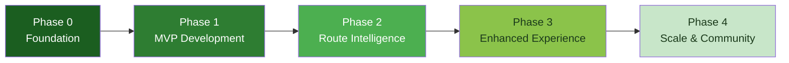

# Roadmap

## Vision

KOLEKTA aims to become the reference open-source platform for urban waste collection tracking in Luanda and, potentially, beyond. The project's purpose is to give citizens reliable, data-driven information about when waste collection vehicles will pass through their neighbourhood — reducing missed collections, street waste accumulation, and frustration.

> [!NOTE]
> This roadmap has **no fixed dates**. Progress depends on community contributions, access to GPS data, and engagement with waste collection operators. Each phase builds on the previous one.
>
> In accordance with [PD-010](PRODUCT_DECISIONS.md#pd-010-mvp-scope-definition--option-a-live-tracking--proximity-only), Phase 1 is strictly focused on live tracking and proximity alerts. Route intelligence and passage predictions are developed in Phase 2 once real operational telemetry has accumulated.

---

## Phase Overview

---

## Phase 0: Foundation (Current Phase)

Establish the project's identity, documentation, and prerequisites for development.

| Item | Status | Notes |
|------|--------|-------|
| Brand identity (logo, colors, typography) | ✅ Done | See [Brand Guidelines](BRAND_GUIDELINES.md) |
| Project documentation | ✅ Done | Core docs created |
| Repository structure | ✅ Done | Documentation repository with `docs/` and `assets/`. |
| Open-source license selection | ✅ Done | AGPL-3.0 approved and applied. See [LICENSE](../LICENSE) and [PD-003](PRODUCT_DECISIONS.md#pd-003-open-source-licensing-model). |
| Community communication channels | ⏳ Pending | Platform selection needed (GitHub Discussions, Discord, etc.) |
| GPS data source identification | ⏳ Pending | Research into available tracking platforms and operator willingness |
| Operator outreach | ⏳ Pending | Initial conversations with waste collection operators in Luanda |
| Contribution documents & Security | ✅ Done | `CONTRIBUTING.md`, `CODE_OF_CONDUCT.md`, and `SECURITY.md` configured with active contact. |
| Governance | ⏳ Pending | Maintainer rules and formal governance charter to be established. |

### Exit Criteria for Phase 0

- License selected and applied.
- At least one communication channel established.
- At least one potential GPS data source identified (not necessarily secured).

---

## Phase 1: MVP Development

Build the minimum viable product — a working system that can ingest GPS data, display vehicle positions on a map, and send basic proximity notifications.

| Item | Component | Description |
|------|-----------|-------------|
| Backend core | NestJS | API server with GPS ingestion endpoints |
| Database | PostgreSQL + PostGIS | Schema for vehicles, positions, operators |
| GPS ingestion API | Backend | `POST /api/v1/gps/positions` and batch endpoint |
| Basic trajectory storage | Backend | Store incoming positions, construct simple trajectories |
| Frontend application | React / Next.js | Web application with map interface |
| Map integration | MapLibre + OSM | Display Luanda map with vehicle positions |
| Real-time positions | WebSockets | Live vehicle position updates on the map |
| Citizen location | Frontend | Allow citizens to select their location on the map |
| Proximity notifications | Web Push | Basic "a truck is near you" notifications |
| Docker Compose | Infrastructure | Development environment with all services |
| Initial test suite | All | Unit tests for critical paths |

### Exit Criteria for Phase 1

- GPS data can be ingested via API and displayed on the map in real time.
- A citizen can open the web app, see active vehicles, select their location, and receive a notification when a vehicle approaches.
- The system runs via `docker compose up`.

---

## Phase 2: Route Intelligence

Add the prediction engine — the core differentiator of KOLEKTA. Transform raw GPS data into actionable predictions.

| Item | Component | Description |
|------|-----------|-------------|
| Trajectory construction pipeline | Python worker | Connect GPS points into meaningful paths |
| Trip segmentation | Python worker | Identify individual collection trips |
| Pattern extraction | Python worker | Find repeating route patterns (day-of-week, time windows) |
| Route template generation | Python worker | Create representative routes from trajectory clusters |
| Passage time estimation | Python worker | Predict when a vehicle will pass a given point |
| Prediction confidence | Backend / Frontend | Display confidence levels to citizens |
| Collection stop detection | Python worker | Basic classification of vehicle stops |
| Prediction API | Backend | `GET /api/v1/predictions/nearby` endpoint |

> [!IMPORTANT]
> Phase 2 relies on **accumulated GPS data** from Phase 1. Pattern extraction requires at least several weeks of continuous data for a given operator before meaningful predictions can be generated.

### Exit Criteria for Phase 2

- The system can predict, with stated confidence, when a vehicle is likely to pass near a citizen's location.
- Predictions are based on observed historical patterns, not manual configuration.
- Collection stops are detected and classified.

See [Route Prediction](ROUTE_PREDICTION.md) for detailed technical design.

---

## Phase 3: Enhanced Experience

Improve accuracy, add operator-facing features, and polish the citizen experience.

| Item | Component | Description |
|------|-----------|-------------|
| Improved prediction accuracy | Python worker | Better clustering, refined confidence scoring |
| Multi-operator support | Backend | Handle multiple operators with distinct fleets and routes |
| Operator dashboard (basic) | Frontend | Fleet overview, trip history, basic analytics |
| Historical route visualization | Frontend | Show past routes on the map with filters |
| Notification preferences | Frontend | Citizens control notification timing, frequency, radius |
| PWA offline improvements | Frontend | Offline support, cached predictions, install prompt |
| Performance optimization | All | Query optimization, caching strategy, load testing |
| API documentation portal | Docs | Interactive API docs (Swagger/ReDoc) |

### Exit Criteria for Phase 3

- Multiple operators can use the system simultaneously.
- Operators can view their fleet's activity and basic analytics.
- Citizens have control over their notification experience.

---

## Phase 4: Scale & Community

Grow the project's reach and consider advanced features.

| Item | Component | Description |
|------|-----------|-------------|
| Advanced prediction algorithms | Python worker | Evaluate ML models — **only** if justified by data volume and demonstrated need |
| Community feedback mechanisms | Frontend | Citizens can report missed collections, confirm/deny predictions |
| Contributor onboarding | Docs | Improved documentation, tutorials, "good first issue" labels |
| Expansion readiness | All | Generalize for cities beyond Luanda (if applicable) |
| Internationalization improvements | Frontend | Better i18n support, additional languages |
| Public API for third parties | Backend | Stable, documented API for external integrators |

> [!CAUTION]
> Machine learning is introduced in Phase 4 **only if** simpler statistical methods (Phases 1–3) are demonstrably insufficient. Premature ML adds complexity without proportional benefit. See [Route Prediction — Future Evolution Path](ROUTE_PREDICTION.md#future-evolution-path).

### Exit Criteria for Phase 4

- The project has active external contributors.
- Prediction quality is measurably improved over Phase 2 baselines.
- The system is documented well enough for deployment in a new city.

---

## How to Contribute to the Roadmap

This roadmap is a living document. Community input shapes priorities.

- **Propose a feature or change**: Open a GitHub issue with the `roadmap` label.
- **Discuss priorities**: Use the community channels (⏳ to be established).
- **Contribute code**: See [CONTRIBUTING.md](../CONTRIBUTING.md) for guidelines.
- **Report real-world context**: If you live in Luanda or work in waste management, your insights are especially valuable.

---

## Cross-References

- [MVP Scope](MVP_SCOPE.md) — detailed scope and boundaries of the MVP
- [Product Requirements](PRODUCT_REQUIREMENTS.md) — full product requirements document
- [Route Prediction](ROUTE_PREDICTION.md) — technical design for the prediction engine
- [API Specification](API_SPECIFICATION.md) — conceptual API design
- [System Architecture](SYSTEM_ARCHITECTURE.md) — overall system design
