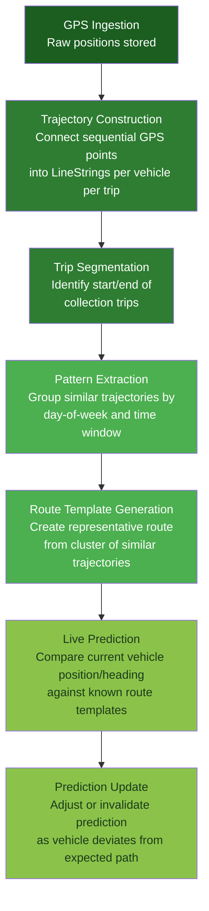
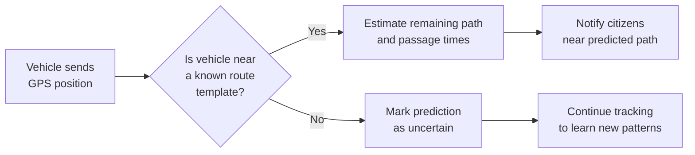
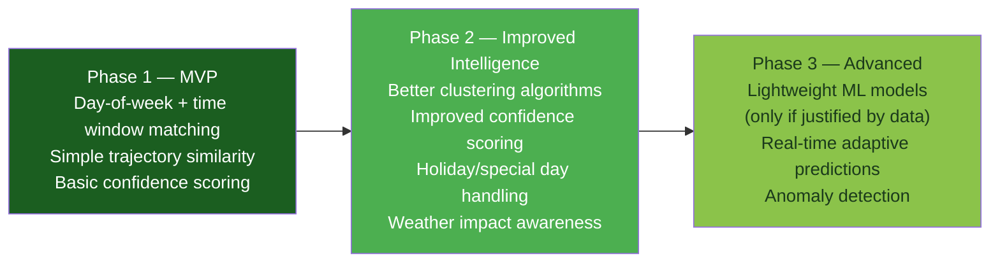

# Route Prediction

> **Status**: Design document — not yet implemented.
>
> [!WARNING]
> This document describes more than one phase in a single pipeline. Stages 1–4 are historical processing. Stages 5–6 compare a live position with those patterns and can invalidate an estimate. Invalidation is post-MVP ([FR-S07](PRODUCT_REQUIREMENTS.md)). Whether a basic passage estimate is in the MVP at all is unresolved between [MVP Scope](MVP_SCOPE.md) and the [Roadmap](ROADMAP.md).
>
> Names here do not all match the [data model](DATA_MODEL.md). `trajectories` and `route_patterns` are the schema entities. "Trip" and "route template" in this document are descriptions of those ideas, not additional approved tables. Gap thresholds also disagree: 10 minutes here, 30 minutes in the data model. Neither figure is decided.

## Philosophy

KOLEKTA's prediction engine starts simple and evolves based on real data. The project deliberately avoids complex machine learning in early phases. The initial approach relies on **statistical pattern matching** from historical GPS trajectories.

Key principles:

- **Data-driven, not assumption-driven** — predictions emerge from observed vehicle behaviour, not from manually registered routes.
- **Start simple** — day-of-week and time-window matching is the first predictor. More sophisticated techniques are introduced only when simpler methods are demonstrably insufficient.
- **Transparent confidence** — every prediction carries a confidence level so citizens understand the reliability of the estimate.
- **Graceful degradation** — when data is sparse or a vehicle deviates from known patterns, the system says "I don't know" rather than guessing badly.

---

## Prediction Pipeline



Each stage is described in detail below.

---

## Stage 1 — Trajectory Construction

Raw GPS positions are individual latitude/longitude points with timestamps. The first processing step connects them into meaningful paths.

### Process

1. Select all GPS positions for a given vehicle, ordered by timestamp.
2. Walk through positions sequentially. If the time gap between two consecutive points exceeds a **gap threshold**, start a new trajectory segment. This document proposes 10 minutes. The data model proposes 30 minutes. The value is not decided.
3. Apply noise reduction:
   - **Simple moving average** — smooth latitude and longitude independently over a small window (e.g., 3–5 points).
   - **Douglas-Peucker simplification** — reduce point density on straight segments while preserving turns (tolerance ~10–20 m, tunable).
4. Store the resulting trajectory as a **PostGIS `LineString`** with associated metadata (vehicle ID, start time, end time, point count).

### Handling Edge Cases

| Scenario | Behaviour |
|----------|-----------|
| Single isolated point | Discarded (not a trajectory) |
| Two points far apart in time | Two separate single-point segments, both discarded |
| Very short trajectory (< 3 points) | Stored but flagged; excluded from pattern extraction |
| GPS drift while stationary | Detected by near-zero displacement; collapsed to a single point |

---

## Stage 2 — Trip Segmentation

A trajectory may contain multiple logical trips (e.g., a vehicle does a morning run, returns to the depot, then does an afternoon run). Trip segmentation splits trajectories into individual collection runs.

### Depot Detection

- Cluster trajectory start and end points across many trajectories for the same operator.
- Dense clusters of start/end points indicate **depot locations**.
- Depot locations are stored and updated as new data arrives.

### Trip Boundaries

A **trip begins** when a vehicle moves away from a depot area (exits a configurable geofence radius, e.g., 200 m).

A **trip ends** when any of these conditions is met:

- Vehicle returns to a depot area.
- Vehicle is stationary for an extended period (configurable threshold, suggested default: **30+ minutes**).
- A time gap exceeding the gap threshold is encountered (already handled during trajectory construction).

### Output

Each trip becomes a record with:

- `trip_id`
- `vehicle_id`
- `operator_id`
- `start_time`, `end_time`
- `start_location`, `end_location`
- `trajectory` (PostGIS `LineString`)
- `point_count`
- `total_distance_meters`

---

## Stage 3 — Pattern Extraction

Once enough trips are stored, the system looks for repeating patterns.

### Grouping Dimensions

Trips are grouped by:

| Dimension | Example |
|-----------|---------|
| Operator | Operator A, Operator B |
| Day of week | Monday, Tuesday, … Sunday |
| Time window | Morning (05:00–12:00), Afternoon (12:00–18:00), Evening (18:00–23:00) |

> [!NOTE]
> Time windows are configurable. The defaults above are a starting point and should be adjusted based on observed data.

### Trajectory Similarity

Within each group, trajectory similarity is measured using:

- **Fréchet distance** — measures the maximum deviation between two curves, accounting for the order of points. Preferred for route comparison.
- **Hausdorff distance** — alternative; measures the maximum minimum distance between point sets. Simpler but less sensitive to ordering.

### Clustering

- Use simple **distance-based clustering** (e.g., hierarchical agglomerative clustering with a distance threshold).
- This is deliberate — no ML-based clustering (DBSCAN, k-means) in Phase 1.
- A cluster must contain a **minimum of 3 matching trajectories** before it is considered a reliable pattern.

### Output

Each pattern (cluster) produces:

- A set of member trip IDs
- Similarity statistics (mean pairwise distance, max deviation)
- Temporal metadata (typical start time range, typical duration)

---

## Stage 4 — Route Template Generation

From each cluster of similar trajectories, the system generates a single **route template** — the representative path that will be used for prediction.

### Approach

1. **Median trajectory** — compute the geometric median of all trajectories in the cluster at regularly sampled points along the path. This reduces the effect of outlier trajectories.
2. **Fallback: most complete trajectory** — if the cluster is small (e.g., exactly 3 trips), select the trajectory with the most points and greatest coverage as the representative.

### Template Attributes

| Attribute | Description |
|-----------|-------------|
| `template_id` | Unique identifier |
| `operator_id` | Associated operator |
| `geometry` | Representative `LineString` (PostGIS) |
| `day_of_week` | Day(s) this pattern applies to |
| `typical_start_time` | Range (e.g., 06:15–06:45) |
| `typical_duration` | Range (e.g., 2h30m–3h15m) |
| `confidence_score` | How consistent the cluster is (0.0–1.0) |
| `sample_count` | Number of trips in the cluster |
| `last_observed` | Timestamp of most recent matching trip |

### Confidence Score Calculation

```
confidence = f(cluster_size, cluster_tightness, recency)

where:
  cluster_size    — more matching trips → higher confidence
  cluster_tightness — lower mean pairwise distance → higher confidence
  recency         — more recent observations → higher confidence
```

Exact formula is [PENDING] — to be calibrated once real data is available.

---

## Stage 5 — Live Prediction

When a vehicle is actively transmitting GPS positions, the system attempts to match its current path against known route templates.

### Matching Process



1. Filter route templates by: operator, current day of week, current time window.
2. Check if the vehicle's recent trajectory (last N points) is geometrically close to any template's corresponding segment.
3. If a match is found:
   - Project the vehicle's position onto the template path.
   - Estimate passage times for downstream points based on historical speed profiles along the template.
   - Publish predictions for citizen notification.
4. If no match is found:
   - Set prediction confidence to `None`.
   - Continue recording the trajectory for future pattern extraction.

### Estimated Time of Passage (ETP)

For each point along the predicted remaining path:

```
ETP = current_time + estimated_travel_time(current_position → target_point)
```

`estimated_travel_time` is derived from historical speed along the same segment of the route template. If that history is missing, the system must not fill the gap with a default speed. It omits the numeric estimate and reports that confidence is insufficient. A fabricated travel time would violate the rule that sparse data produces "no estimate", not a guess.

---

## Stage 6 — Prediction Update

Predictions are not static. As the vehicle continues to transmit positions, the system continuously re-evaluates.

| Event | Action |
|-------|--------|
| Vehicle continues on predicted route | Tighten ETP estimates, maintain or increase confidence |
| Vehicle takes a minor detour | Keep prediction active but reduce confidence slightly |
| Vehicle deviates significantly | Invalidate current prediction, attempt to match a different template |
| Vehicle stops for an extended period | Do not tell citizens that waste was collected. A stop is ambiguous (traffic, depot, break, or collection). Pausing an estimate is an internal inference. Notifying citizens about a detected stop is post-MVP ([FR-C05](PRODUCT_REQUIREMENTS.md)) and requires the corroboration rules below. |
| Vehicle returns to predicted route after deviation | Restore prediction, adjust ETPs |

---

## Prediction Confidence Levels

| Level | Criteria | User-facing message (example) |
|-------|----------|-------------------------------|
| **High** | Vehicle is following a well-established pattern (many historical matches, currently on route) | "A truck is expected near you around 07:30" |
| **Medium** | Vehicle is near a known route but hasn't confirmed the full path yet | "A truck may pass near you this morning" |
| **Low** | Limited historical data or trip is still early | "A truck is active in your area" |
| **None** | Vehicle is not matching any known pattern | No prediction shown |

> [!IMPORTANT]
> Predictions are **estimates**, never guarantees. The UI must communicate this clearly to citizens.

---

## Collection Stop Detection

Detecting whether a vehicle actually collected waste at a given location is non-trivial. A vehicle stopping briefly could indicate a traffic light, traffic congestion, a driver break, or actual waste collection.

### Why Caution Is Needed

A vehicle stopping for 1 minute is **NOT** sufficient evidence of waste collection. False positives erode citizen trust.

### Classification Signals

The system considers multiple signals before classifying a stop:

| Signal | Weight | Rationale |
|--------|--------|-----------|
| Stop duration (minimum 2–3 minutes) | High | Collection takes time |
| Proximity to residential areas | Medium | Collection happens where people live |
| Recurrence of stops at similar locations | High | Regular stops at the same spot suggest a collection point |
| Time of day | Low | Collection typically happens during specific hours |
| Position on a known collection route | High | Stops on a known route are more likely to be collection |
| Vehicle speed before/after stop | Low | Slow approach + slow departure suggests collection |

### Classification Levels

| Classification | Meaning |
|----------------|---------|
| `possible_collection` | Some signals present but not enough for confidence |
| `likely_collection` | Multiple corroborating signals; probably a collection stop |
| `traffic` | Short duration, on a road, no collection-related signals. The data model uses this name. |
| `unknown` | Insufficient information to classify |

> [!WARNING]
> Require **multiple corroborating signals** before classifying a stop as `likely_collection`. A single signal (e.g., duration alone) is insufficient.

---

## What This System Does NOT Do

- **Does not guarantee collection times** — all predictions are estimates based on historical patterns.
- **Does not use machine learning** in the initial implementation — statistical methods only.
- **Does not require operators to register routes manually** — routes are inferred from GPS data.
- **Does not keep a named citizen profile** — the MVP has no user account. Citizens may opt in to a notification zone that stores their selected location with a push subscription for up to 30 days ([PD-009](PRODUCT_DECISIONS.md#pd-009-server-side-citizen-locations-for-background-notifications)).
- **Does not replace official operator schedules** — if operators publish schedules, KOLEKTA complements (not replaces) them.

---

## Future Evolution Path



| Phase | Approach | Prerequisite |
|-------|----------|-------------|
| **Phase 1 (MVP)** | Day-of-week + time window matching with simple trajectory similarity | GPS data flowing, basic trajectory pipeline |
| **Phase 2** | Improved clustering, better confidence scoring, holiday/special day handling | Months of accumulated data, Phase 1 operational |
| **Phase 3** | Consider lightweight ML models (e.g., time-series forecasting) | Sufficient data volume AND demonstrable failure of simpler methods |

> [!CAUTION]
> Phase 3 ML introduction is conditional. Machine learning is only justified when simpler statistical methods are demonstrably insufficient for the prediction quality required. Premature ML adds complexity without proportional benefit.

---

## Technical Implementation Notes

| Aspect | Choice | Notes |
|--------|--------|-------|
| Primary language | Python | GeoPandas, Shapely for geometry; PostGIS integration via SQLAlchemy + GeoAlchemy2 |
| Spatial storage | PostgreSQL + PostGIS | All trajectories, templates, and spatial queries |
| Cache | Redis | Active predictions, current vehicle positions |
| Batch processing | Python workers | Pattern extraction runs on schedule (e.g., nightly) |
| Near-real-time processing | Python workers | Live prediction runs on each incoming GPS position |
| Libraries to evaluate | scikit-mobility, movingpandas | For trajectory analysis, similarity computation |

### Processing Cadence

| Task | Frequency |
|------|-----------|
| Trajectory construction | As GPS data arrives (near-real-time) |
| Trip segmentation | After trajectory completion (when vehicle returns to depot or gap detected) |
| Pattern extraction | Batch — nightly or weekly |
| Route template generation | Batch — after pattern extraction |
| Live prediction | On each GPS position update |
| Template refresh | Periodic — as new patterns emerge |

---

## Cross-References

- [GPS Integration](GPS_INTEGRATION.md) — how GPS data enters the system
- [Data Model](DATA_MODEL.md) — database schema for trajectories, templates, and predictions
- [System Architecture](SYSTEM_ARCHITECTURE.md) — how the prediction pipeline fits into the overall system
