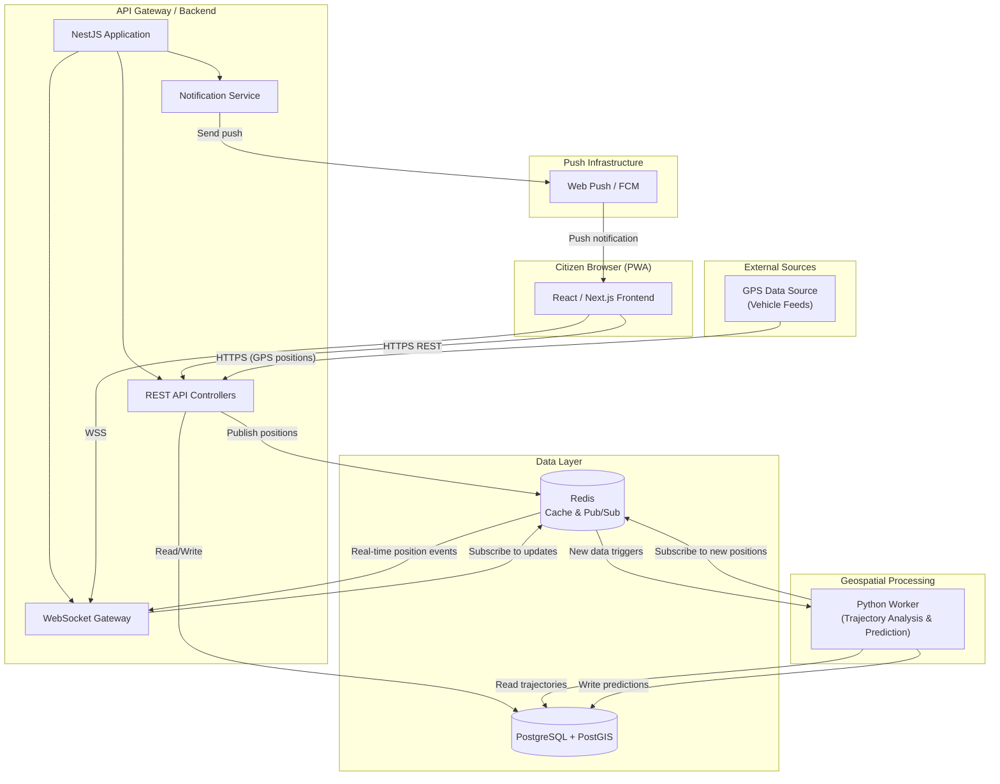
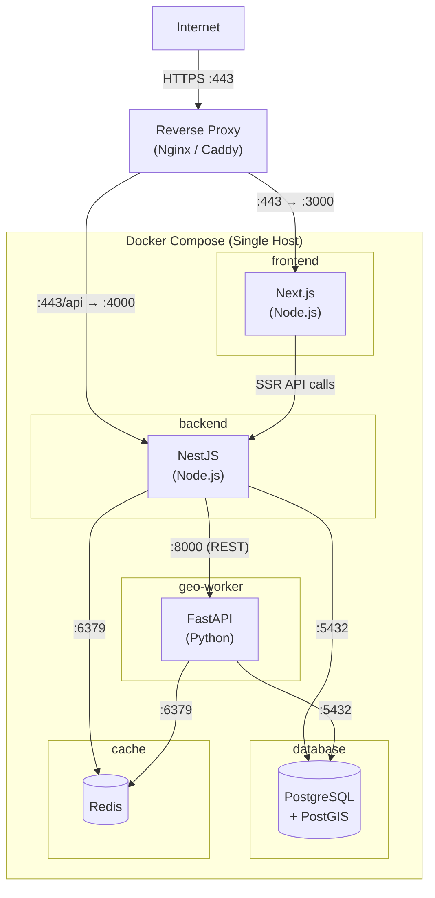

# System Architecture

> **Document Status:** Living document — updated as architectural decisions are confirmed.
>
> **Last Updated:** 2026-10-31

## Overview

KOLEKTA follows a **modular monolith** architecture with clearly separated concerns. The system is intentionally **not** microservices — it is a modular NestJS backend with a separate Python geospatial processing worker, connected via Redis pub/sub and direct REST API calls.

This approach keeps operational complexity low during the early stages of the project while preserving the ability to extract services later if scaling demands it. The Python worker is separate because batch geospatial work has a different runtime from the API. GeoPandas and Shapely are the libraries named for that work. scikit-mobility and scikit-learn are candidates to evaluate later. They are not MVP dependencies, and they are not a reason to put prediction on the ingestion path.

> [!IMPORTANT]
> [PD-004](PRODUCT_DECISIONS.md) marks the stack as **proposed**. Tables later in this document that say "Chosen" mean "current recommendation inside that proposal". They are not approved decisions.
>
> [PD-005](PRODUCT_DECISIONS.md) describes the worker as a separate process that reads and writes the shared database, with Redis optional. An internal FastAPI on the worker, and a Redis subscription that recomputes patterns on every position, go beyond that decision and are not approved.

### Design Principles

| Principle | Description |
|---|---|
| **Simplicity first** | Avoid premature optimization and over-engineering. |
| **Open-source stack** | Every component must be free and open-source. |
| **Offline-aware** | The PWA must function gracefully with intermittent connectivity. |
| **Data-driven** | Architectural choices prioritize geospatial data processing performance. |
| **Privacy by design** | No user accounts in MVP; store notification zones only after opt-in and delete them within 30 days. |

---

## High-Level Architecture

### Data Flow Summary

1. **GPS ingestion:** Vehicle GPS devices send position observations to the NestJS REST API.
2. **Storage and broadcast:** The API validates the observation, stores it in PostGIS, and publishes that same observation to Redis.
3. **Real-time updates:** The WebSocket gateway subscribes to Redis and pushes the observation to connected clients. The payload is a reported position, not a prediction.
4. **Historical processing, off the request path:** A scheduled Python job reads stored observations, builds trajectories, and updates route patterns. It does not run inside the ingestion request. Stop detection is post-MVP.
5. **Predictions:** A passage estimate is read from stored patterns. It is labelled as an estimate, with a confidence value, and is not written back into `gps_positions`.
6. **Notifications:** In-session proximity alerts use client-side location. If a citizen opts in to background push, the server stores a notification zone and push subscription for up to 30 days, evaluates new vehicle positions against it, and deletes it on unsubscribe or expiry. See [PD-009](PRODUCT_DECISIONS.md#pd-009-server-side-citizen-locations-for-background-notifications).

---

## Component Descriptions

### 1. Citizen Browser (PWA) — React / Next.js

| Aspect | Detail |
|---|---|
| **Responsibility** | Map-based UI showing vehicle positions, predicted collection times, and notification sign-up. |
| **Technology** | React 18+ with Next.js (App Router). |
| **Key interfaces** | Consumes REST API and WebSocket connections from the backend. |
| **Scalability** | Static assets served via CDN; no server-side state per user. |

The frontend is a Progressive Web App (PWA) with Service Worker support for offline caching. It renders an interactive map via MapLibre GL JS, displays real-time vehicle positions, and allows citizens to register a notification zone by dropping a pin on the map.

### 2. API Gateway / Backend — NestJS

| Aspect | Detail |
|---|---|
| **Responsibility** | HTTP API, WebSocket gateway, GPS ingestion, notification orchestration, business logic. |
| **Technology** | NestJS 10+ running on Node.js. TypeORM or MikroORM for database access. |
| **Key interfaces** | REST endpoints (see [API Specification](API_SPECIFICATION.md)), WebSocket channels, Redis pub/sub. |
| **Scalability** | Stateless — can be horizontally scaled behind a load balancer. |

NestJS modules are organized by domain:

- `gps` — GPS position ingestion and validation
- `vehicles` — Vehicle and operator management
- `trajectories` — Trajectory queries
- `predictions` — Route pattern and collection time prediction queries
- `notifications` — Web Push subscription management and dispatch
- `websocket` — Real-time position broadcasting

### 3. PostgreSQL + PostGIS

| Aspect | Detail |
|---|---|
| **Responsibility** | Primary data store for all structured and geospatial data. |
| **Technology** | PostgreSQL 16+ with PostGIS 3.4+ extension. |
| **Key interfaces** | SQL with spatial functions (ST_Distance, ST_Within, ST_DWithin, ST_MakeLine, etc.). |
| **Scalability** | Vertical scaling initially; table partitioning for gps_positions by time range. |

PostGIS provides industry-standard geospatial data types (`GEOMETRY`, `GEOGRAPHY`) and spatial indexing (GiST). All coordinate data uses WGS84 (SRID 4326).

See [Data Model](DATA_MODEL.md) for the full schema.

### 4. Redis — Cache & Pub/Sub

| Aspect | Detail |
|---|---|
| **Responsibility** | Caching frequently-read data (route patterns, vehicle status), real-time pub/sub for position broadcasts, and rate limiting counters. |
| **Technology** | Redis 7+. |
| **Key interfaces** | Redis pub/sub channels for position events; key-value cache for predictions. |
| **Scalability** | Single instance is sufficient for early scale; Redis Cluster if needed later. |

Redis channels:

- `gps:positions:{operator_code}` — New GPS positions, per operator.
- `vehicles:status` — Vehicle online/offline state changes.
- `notifications:trigger` — Proximity alert triggers.

### 5. Geospatial Worker — Python

| Aspect | Detail |
|---|---|
| **Responsibility** | Trajectory construction, stop detection, route pattern learning, and prediction model updates. |
| **Technology** | Python 3.11+ with GeoPandas, Shapely, and SQLAlchemy + GeoAlchemy2. Heavier libraries are not selected. |
| **Key interfaces** | Reads and writes PostGIS. Redis is an optional signal that new observations exist. A worker HTTP API is not part of the approved design. |
| **Scalability** | Can run multiple worker instances partitioned by operator or geographic zone. |

The worker runs as a separate Docker container. It performs computationally intensive geospatial operations that benefit from Python's mature library ecosystem.

Key processing tasks:

- **Trajectory segmentation** — Group sequential GPS observations into trip segments. Thresholds are proposed and not agreed. See [Route Prediction](ROUTE_PREDICTION.md).
- **Stop detection** — Post-MVP. A pause is not classified as collection on the strength of low speed alone.
- **Route pattern extraction** — Batch. Group similar historical trajectories by day of week and time window.
- **Confidence scoring** — Proposed. The numeric formula is not decided. Every public estimate must carry a confidence label and must be distinguishable from a GPS observation.

### 6. GPS Data Source

| Aspect | Detail |
|---|---|
| **Responsibility** | Provide real-time and historical GPS position data from waste collection vehicles. |
| **Technology** | ⏳ [PENDING] — Source not yet confirmed. See [GPS Integration](GPS_INTEGRATION.md). |
| **Key interfaces** | HTTPS POST to the ingestion API. |
| **Scalability** | Design supports multiple concurrent GPS sources with per-operator API keys. |

> [!IMPORTANT]
> No GPS data source agreements are currently in place. The architecture is designed to accept data from multiple possible sources — see [GPS Integration](GPS_INTEGRATION.md) for the full integration strategy.

### 7. WebSocket Server

| Aspect | Detail |
|---|---|
| **Responsibility** | Push real-time vehicle positions and status updates to connected browser clients. |
| **Technology** | NestJS WebSocket gateway using Socket.IO or native WebSockets. |
| **Key interfaces** | WSS connection from the PWA; subscribes to Redis pub/sub internally. |
| **Scalability** | Sticky sessions or Redis adapter for multi-instance WebSocket support. |

### 8. Notification Service

| Aspect | Detail |
|---|---|
| **Responsibility** | Send push notifications when a vehicle approaches a citizen's notification zone. |
| **Technology** | Web Push API (VAPID) for browsers; Firebase Cloud Messaging (FCM) as a fallback transport. |
| **Key interfaces** | Receives trigger events from Redis; manages push subscriptions in PostGIS. |
| **Scalability** | Notification dispatch is asynchronous and idempotent. |

---

## Technology Decisions & Trade-offs

### Frontend: React / Next.js

| Option | Pros | Cons | Decision |
|---|---|---|---|
| **React + Next.js** ✅ | Largest ecosystem, SSR for SEO, built-in routing, API routes, strong PWA tooling | Higher complexity than a plain SPA; opinionated project structure | **Chosen** — ecosystem size maximizes potential contributor pool |
| Vue.js + Nuxt.js | Equally capable, gentler learning curve, excellent DX | Smaller contributor pool globally | Valid alternative |
| Plain React SPA | Simpler build setup | No SSR, manual routing, weaker SEO, slower initial load | Rejected |
| Svelte / SvelteKit | Excellent performance, small bundle size | Smallest ecosystem, fewer contributors likely | Not considered |

**Key trade-off:** Next.js adds build complexity and framework opinions, but provides SSR (important for initial load on slower Luanda mobile networks), file-based routing, and API routes that simplify development.

### Backend: NestJS

| Option | Pros | Cons | Decision |
|---|---|---|---|
| **NestJS** ✅ | Modular architecture, TypeScript-native, decorators, DI, excellent structure for growing codebases | Steeper learning curve, heavier abstraction layer | **Chosen** — structure pays off as the project grows |
| Express.js | Simple, minimal, huge middleware ecosystem | No structure enforced, becomes messy at scale | Rejected |
| Fastify | Faster raw performance, schema-based validation | Smaller ecosystem, less structured | Considered |
| Python (FastAPI) | Could unify with geospatial worker, excellent async support | Loses TypeScript consistency with frontend, two languages for backend logic | Rejected for main API |
| Python (Django) | Batteries-included, admin panel, ORM with GIS support (GeoDjango) | Monolithic, heavier, Python-only stack | Rejected |

**Key trade-off:** NestJS has a steeper learning curve than Express, but its module system, dependency injection, and decorator-based routing provide essential structure. TypeScript consistency between frontend and backend reduces context-switching for contributors.

### Database: PostgreSQL + PostGIS

| Option | Pros | Cons | Decision |
|---|---|---|---|
| **PostgreSQL + PostGIS** ✅ | Industry-standard geospatial, mature, reliable, rich spatial functions, open-source | Requires spatial expertise, more complex than a basic RDBMS setup | **Chosen** — PostGIS is the gold standard for geospatial data |
| MongoDB + geospatial indexes | Flexible schema, easy to start | Weaker spatial query capabilities, no true linestring operations, limited spatial joins | Rejected |
| TimescaleDB | Excellent for time-series (GPS data is time-series) | Less mature spatial support, adds extension complexity | Considered for gps_positions table only |
| SQLite + SpatiaLite | Zero-config, embedded | Not suitable for concurrent access or production workloads | Rejected |

**Key trade-off:** PostGIS adds operational complexity (extension management, spatial index tuning) but provides capabilities that are essential for trajectory analysis, stop detection, and proximity queries. No other open-source option matches its spatial query performance.

> [!NOTE]
> TimescaleDB could complement PostGIS for the `gps_positions` table (which is fundamentally time-series data). This is a potential future optimization, not an MVP requirement.

### Geospatial Processing: Separate Python Worker

| Option | Pros | Cons | Decision |
|---|---|---|---|
| **Separate Python worker** ✅ | Access to GeoPandas, Shapely, scikit-mobility, scikit-learn; mature spatial analysis ecosystem | Operational complexity (two runtimes), inter-service communication overhead | **Chosen** — Python's geospatial ecosystem is unmatched |
| Integrated into NestJS (Turf.js) | Single runtime, simpler deployment | Turf.js is limited for trajectory analysis, no equivalent to scikit-mobility | Rejected |
| R-based processing | Excellent spatial statistics | Poor production deployment story, niche contributor pool | Not considered |

**Key trade-off:** Running a separate Python process adds Docker containers and inter-service communication, but Python's geospatial libraries are significantly more capable for trajectory segmentation, clustering, and predictive modeling. The NestJS backend handles simple spatial queries (proximity checks) directly via PostGIS.

**Communication pattern:**
- **Real-time triggers:** Redis pub/sub notifies the worker of new GPS data batches.
- **Batch processing:** The worker runs scheduled jobs to rebuild trajectory aggregations and route patterns.
- **On-demand requests:** The NestJS backend calls the worker's FastAPI endpoints for specific geospatial computations.

### Maps: MapLibre + OpenStreetMap

| Option | Pros | Cons | Decision |
|---|---|---|---|
| **MapLibre GL JS** ✅ | Free, open-source, vector tiles, WebGL-powered, performant with many markers | Requires self-hosted or third-party tile server | **Chosen** — open-source, no per-request costs |
| Leaflet | Simple, well-documented, mature | Raster-only (without plugins), slower with many markers, no vector tiles natively | Considered as fallback |
| Google Maps | Familiar UX, excellent data quality | Proprietary, per-request pricing, vendor lock-in | Rejected |
| Mapbox GL JS | Feature-rich, excellent DX | Source-available license (not fully open-source since v2), usage-based pricing | Rejected |

**Key trade-off:** MapLibre requires setting up a tile server (or using a free tile provider), but eliminates per-request costs that would be prohibitive for a civic project. Vector tiles enable smooth zooming and efficient rendering of vehicle tracks.

---

## Deployment Architecture

### Container Configuration

| Container | Base Image | Exposed Port | Volumes |
|---|---|---|---|
| `frontend` | `node:20-alpine` | 3000 | — |
| `backend` | `node:20-alpine` | 4000 | — |
| `geo-worker` | `python:3.11-slim` | 8000 | — |
| `database` | `postgis/postgis:16-3.4` | 5432 | `pgdata:/var/lib/postgresql/data` |
| `cache` | `redis:7-alpine` | 6379 | `redisdata:/data` |

### Reverse Proxy

A reverse proxy (Nginx or Caddy) terminates TLS and routes traffic:

- `/` → frontend container (port 3000)
- `/api/*` → backend container (port 4000)
- `/ws` → backend container WebSocket upgrade (port 4000)

> [!TIP]
> Caddy provides automatic HTTPS via Let's Encrypt with zero configuration, making it an excellent choice for initial deployment.

---

## Security Architecture

### Transport Security

- **HTTPS everywhere** — All client-to-server communication is encrypted via TLS 1.2+.
- **WSS** — WebSocket connections use the secure protocol.
- **Internal communication** — Docker network provides isolation; internal traffic between containers does not traverse the public internet.

### Authentication & Authorization

| Interface | Mechanism | Status |
|---|---|---|
| Citizen PWA → API | No authentication in MVP (public read-only data) | Confirmed for MVP |
| GPS source → Ingestion API | API key per operator | ⏳ [PENDING] mechanism details |
| Admin endpoints | ⏳ [PENDING] — not in MVP scope | ⏳ [PENDING] |
| Worker → Backend | Internal network only, no public exposure | Confirmed |

### Input Validation & Sanitization

- GPS coordinates validated against Luanda bounding box (see [GPS Integration](GPS_INTEGRATION.md)).
- Timestamp reasonableness checks (reject future timestamps, reject timestamps older than a configurable threshold).
- Request payload size limits enforced at the reverse proxy and application level.
- All database queries use parameterized statements (TypeORM / GeoAlchemy2) — no raw SQL interpolation.

### Rate Limiting

- GPS ingestion API: rate-limited per API key (proposed: 1 request/second burst, sustained average based on vehicle count).
- Public API: rate-limited per IP (proposed: 60 requests/minute).
- WebSocket connections: limited per IP (proposed: 5 concurrent connections).
- Rate limiting implemented via Redis-backed middleware.

### CORS Policy

- Restrict `Access-Control-Allow-Origin` to the frontend domain.
- No wildcard origins in production.

### Data Protection

- PostgreSQL data encrypted at rest via filesystem-level encryption (LUKS or equivalent).
- Notification zones pair a precise location with a push subscription and are treated as sensitive. They are stored only after opt-in and deleted on unsubscribe or after 30 days — see [Data Model](DATA_MODEL.md) privacy section.
- No named user profile is stored in the MVP. This does not make notification-zone locations or push endpoints anonymous.

---

## Scalability Path

### Phase 1 — Single-Server Deployment (MVP)

- All containers on a single Docker Compose host.
- Suitable for initial pilot with a limited number of vehicles and users.
- Target: handle up to ~50 concurrent GPS-reporting vehicles and ~1,000 concurrent WebSocket clients.

### Phase 2 — Horizontal Scaling

- Separate the database onto a dedicated host or managed service.
- Run multiple backend instances behind a load balancer.
- Run multiple worker instances partitioned by operator or geographic zone.
- Add Redis Cluster or a managed Redis service if pub/sub throughput becomes a bottleneck.

### Phase 3 — Managed Services (if needed)

- Consider managed PostgreSQL with PostGIS support (e.g., cloud provider offerings).
- Consider managed Redis.
- Consider a CDN for frontend static assets.
- Evaluate whether the worker should become a dedicated microservice with its own API contract.

> [!WARNING]
> Do not prematurely optimize. Phase 1 should be proven insufficient before moving to Phase 2. Premature scaling adds operational complexity that slows down development and increases costs.

---

## Cross-References

| Document | Relevance |
|---|---|
| [Data Model](DATA_MODEL.md) | Full database schema and entity relationships |
| [API Specification](API_SPECIFICATION.md) | REST and WebSocket API contracts |
| [GPS Integration](GPS_INTEGRATION.md) | GPS data source strategy and ingestion details |
| [Route Prediction](ROUTE_PREDICTION.md) | Trajectory analysis and prediction algorithms |
